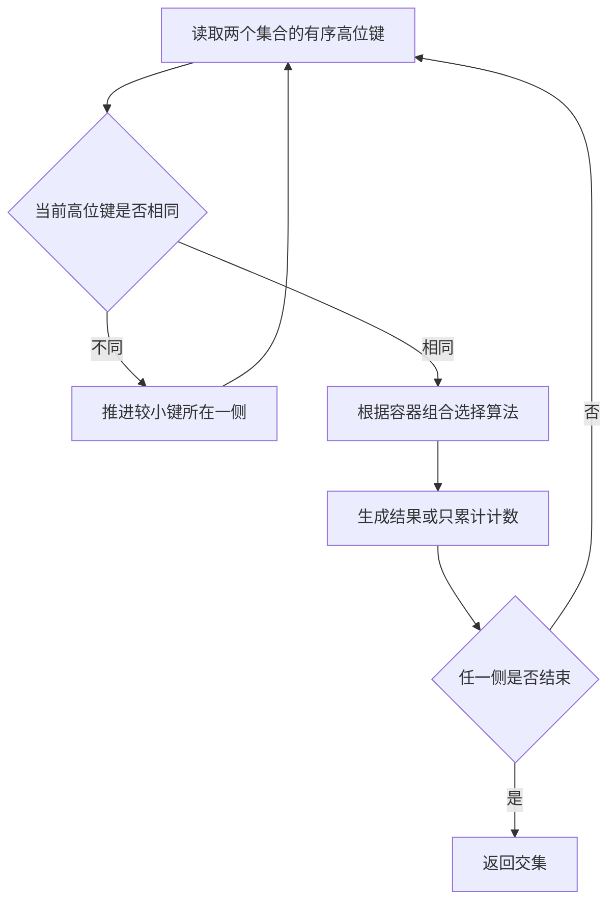
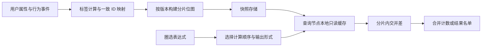

# Roaring Bitmap 深入讲解：从压缩布局到精确集合运算

Roaring Bitmap 的价值，可以用一句话概括：**根据整数在局部的分布选择存储布局，让集合运算尽量少读内存、少做无用功，并保持结果精确。**

它不仅是在解决“怎样把一个集合存小”，还在同时解决“怎样让集合之间的计算更便宜”。理解这两件事的关系，就能理解它为何被用于人群圈选、倒排索引和分析系统，也能判断它什么时候不划算。

本文以“上海会员人群圈选”为主线。先从普通集合讲起，再拆解分桶、三种容器、交并差算法，最后讨论 ID、Redis、并发、分布式和性能验证。示例中的空间数字是明确模型下的推算，性能部分不代表实测结论。

> [!note] 与原始知识点的关系
> 本文扩展自 [[GitHub Daily/GitHub-Trending-日报-2026-10-14]] 中的阿楠专项知识点。原文的方向正确，但有四个表述需要限定：
>
> - 4096 是 Array 与 Bitmap 的空间分界；Run 还取决于连续区间数量。
> - 一次 64 位 AND 处理同一桶内的 64 个候选位置；跨桶跳过是另一层机制。
> - Roaring 是一种精确集合表示。有序数组、哈希集合和普通位图也都可以精确。
> - “千万级集合毫秒级”是一类负载下可能达到的表现，需要测试条件支撑，不能作为普遍承诺。

## 1. 从一个业务问题开始：为什么集合计算会慢？

假设有一亿名用户，我们已经知道：

- 会员集合：哪些用户是会员。
- 上海集合：哪些用户居住在上海。
- 活跃集合：哪些用户最近七天活跃。
- 屏蔽集合：哪些用户不能触达。

目标人群可以写成：

$$
T=(会员\cap 上海\cap 活跃)\setminus 屏蔽
$$

这就是集合的交集与差集。数学表达非常短，但机器需要访问具体的数据才能得到答案。

最直接的实现是逐个检查用户属性。每次请求扫描一亿条记录，重复判断“是不是会员、是不是上海、是否活跃”。数据库索引能减少扫描，但在任意组合大量标签时，我们会想进一步复用已经计算好的条件结果。

于是把方向反过来：**提前为每个标签维护满足条件的用户 ID 集合，请求到来时组合这些集合。**

```text
按用户存属性：                    按标签存用户集合：
用户 101 → 会员、上海             会员 → {101, 102, 108, ...}
用户 102 → 会员、北京             上海 → {101, 105, 108, ...}
用户 105 → 普通、上海             活跃 → {101, 102, 105, ...}
```

这就是倒排索引（Inverted Index）的基本方向：从“对象有哪些属性”，转向“具有某属性的对象有哪些”。Roaring 是表达右侧整数集合的一种方式，它本身不负责判断用户是否符合标签，也不负责自动更新标签。

### 1.1 哈希集合：查找快，不等于批量计算便宜

用哈希集合（Hash Set）计算交集，可以遍历较小集合，再到较大集合中查询。平均查找复杂度接近常数，所以平均工作量约为较小集合的元素数。

问题在常数成本：查哈希桶、比较键、处理碰撞，往往伴随不连续的内存访问。若使用装箱整数，还可能增加对象和垃圾回收开销；使用原生整数集合可以明显改善，但仍要承担哈希表的结构成本。

CPU 运算很快，等待数据从内存到达却可能很贵。算法复杂度相同的两种实现，内存布局不同，实际速度也可能差很多。

### 1.2 有序数组：朴素，却很有竞争力

把整数排好序，两个集合的交集可以像归并排序一样计算。两个指针分别向前移动，遇到相同值就输出。

有序数组紧凑、连续、便于预取。对于小集合、极稀疏集合或以顺序遍历为主的工作负载，它可能比 Roaring 更合适。代价是单个元素插入、删除可能需要移动后续元素。

所以，Roaring 的出发点并非“数组太原始”，恰恰相反：**在适合数组的局部，继续使用数组。**

## 2. 普通位图：把“元素”变成“位置”

位图（Bitmap，也称 Bitset）为每个候选整数安排一个二进制位置。第 i 位为 1，表示 i 属于集合；为 0，表示不属于。

例如候选 ID 为 0 到 7：

```text
ID：       0 1 2 3 4 5 6 7
会员 A：   0 1 1 0 0 1 0 0
上海 B：   0 0 1 1 0 1 0 0
A AND B：  0 0 1 0 0 1 0 0
结果：    {2, 5}
```

原本需要逐个查询的集合操作，现在变成二进制运算：

| 集合操作 | 位运算 | 业务含义 |
|---|---|---|
| 交集 A∩B | AND | 同时满足两个条件 |
| 并集 A∪B | OR | 至少满足一个条件 |
| 差集 A∖B | A AND NOT B | 满足 A，排除 B |
| 对称差 A△B | XOR | 恰好满足其中一个条件 |

在 64 位机器上，一个机器字可以承载 64 个候选位置。一次对应字的 AND，就同时完成这 64 个位置的交集判断。这是**字内并行**，不需要先创建 64 个线程。

对于覆盖 U 个候选位置的普通位图，完整逐字运算的工作量约为：

$$
O\left(\left\lceil\frac{U}{64}\right\rceil\right)
$$

如果使用 SIMD，还可能用一条向量指令处理更多位，但这是具体实现与硬件上的进一步优化。

### 2.1 普通位图的软肋：空间跟 ID 范围走

覆盖一亿个位置，位图有效载荷需要：

$$
100,000,000/8=12,500,000\text{ 字节}\approx11.92\text{ MiB}
$$

即使集合只有两个用户，只要它们的位置相距很远，也可能需要表示中间大量空位置。

覆盖整个 32 位无符号整数空间，需要：

$$
2^{32}/8=512\text{ MiB}
$$

只有两个成员的集合，显然不应该为此支付几百 MiB。

普通位图的矛盾就在这里：**集合运算很便宜，但稀疏 ID 空间可能很浪费。**

## 3. Roaring 的第一步：把大空间切成独立小空间

经典 32 位 Roaring 将整数拆为高 16 位与低 16 位：

$$
h=x\mathbin{\texttt{>>>}}16,\qquad l=x\mathbin{\&}65535
$$

高 16 位决定桶，低 16 位决定桶内位置。这里的桶对应连续整数范围，不是哈希桶。

例如：

```text
整数 x         高 16 位 h       低 16 位 l
     1             0                1
 65537             1                1
 65539             1                3
131079             2                7
```

逻辑布局如下：

```text
顶层：只记录非空桶，高位键保持有序

key = 0 ──→ 容器：{1}
key = 1 ──→ 容器：{1, 3}
key = 2 ──→ 容器：{7}

恢复整数：x = h × 65536 + l
```

最多有 65536 个桶，每桶最多容纳 65536 个不同低位值。空桶直接省略，非空桶自行选择布局。官方格式规范定义了高位键、容器描述与载荷的组织方式。[Roaring 格式规范](https://github.com/RoaringBitmap/RoaringFormatSpec)

这层拆分带来两个收益。

第一，不再为没有成员的巨大空洞分配完整位图。

第二，相同高位只需在桶级表达。桶内如果用数组，每个成员只存两字节低位，而非完整四字节整数。不过，顶层键、指针和容器元数据也需要空间，因此不能简单推导成“任何集合都能节省一半”。

### 3.1 为什么切成 16+16？

可以把它理解为一种实用平衡：桶内值能用 16 位表达；完整桶的普通位图只有 8 KiB；桶的数量也有明确上界。

如果桶太小，会产生更多桶和目录开销。如果桶太大，稠密容器更大，处理一个局部块需要触碰更多内存。16+16 不是所有场景的数学最优解，而是经典 Roaring 选定并经过实践验证的布局。

8 KiB 的工作块也更便于利用缓存，但不能据此声称“所有运算都在 L1 完成”。两个输入、输出、元数据和其他线程都可能争用缓存。

## 4. 三种容器：不仅看密度，还要看连续性

容器（Container）是一个桶内部的集合表示。理解容器，只需抓住两个量：

- c：桶内不同元素的数量，也就是基数（Cardinality）。
- r：桶内连续区间的数量，也就是游程数。

元素少不少，看 c；能不能连成大片，看 r。它们是不同维度。

### 4.1 Array：成员少，就列出成员

数组容器（Array Container）保存有序、去重的 16 位低位值。

```text
{3, 19, 1000} → [3, 19, 1000]
```

忽略元数据和容量预留，有效载荷为 2c 字节。100 个成员需要约 200 字节，4096 个成员需要 8192 字节。

它适合局部稀疏集合：查找可二分，遍历连续，两个数组可以归并求交。

### 4.2 Bitmap：成员多，就给每个位置一位

位图容器（Bitmap Container）为桶内全部 65536 个位置准备位：

$$
65536/8=8192\text{ 字节}=8\text{ KiB}
$$

只要采用这种容器，载荷大小固定。装 5000 个成员与装 50000 个成员，都占相同的位图空间。

数组与位图的载荷在这里相等：

$$
2c=8192\Rightarrow c=4096
$$

对应局部密度为：

$$
4096/65536=6.25\%
$$

**4096 的来源是空间交点。** 对非 Run 容器，标准格式以基数不超过 4096 表示 Array，超过则表示 Bitmap。这个规则不是“所有容器都按密度唯一决定”。[Roaring 格式规范](https://github.com/RoaringBitmap/RoaringFormatSpec)

### 4.3 Run：连续成员多，就记录区间

游程容器（Run Container）记录连续区间。例如：

```text
成员：100, 101, ... , 999
区间：[100, 999]
```

数组要保存 900 个低位值；Run 只需描述起点与连续长度。

标准序列化载荷使用一个两字节游程数，以及每段两字节起点、两字节“长度减一”。因此 r 段的载荷为 2+4r 字节。上述单区间的载荷为 6 字节，不包含桶级及文件级头部。[Roaring 格式规范](https://github.com/RoaringBitmap/RoaringFormatSpec)

由此可以自己推导两个有用的判断：

$$
\text{Run 比 Array 小：}\quad 2+4r<2c
$$

$$
\text{Run 比 Bitmap 小：}\quad 2+4r<8192
$$

前者说明，成员需要足够集中在少数区间里；后者说明，游程数量太多时，固定大小位图反而更便宜。

下面是同一个桶内的三种分布。空间均只计算紧凑载荷：

| 分布 | c | r | Array | Bitmap | Run |
|---|---:|---:|---:|---:|---:|
| 100 个互不相邻的值 | 100 | 100 | 200 B | 8192 B | 402 B |
| 连续的 10000 个值 | 10000 | 1 | 20000 B¹ | 8192 B | 6 B |
| 0 到 65535 的所有偶数 | 32768 | 32768 | 65536 B¹ | 8192 B | 131074 B¹ |

¹ 这些是用于比较的假想编码成本，并非标准 Roaring 应保留的容器形式。

第三行尤其关键：集合有一半位置为 1，已经很稠密，但没有长连续区间，所以 Run 很差。**稠密不等于连续。**

### 4.4 “自适应”不等于每次修改都找全局最小编码

Array 与 Bitmap 可以随增删和运算结果发生转换，但选择 Run 往往还需要检查游程数量。

Java 实现提供 `runOptimize()`，用于在适合时转换为 Run；区间操作也可能直接产生 Run。实现会在表示大小、扫描成本和转换成本之间取舍，不保证每一次 `add()` 后都立即得到字节数最小的布局。[Run 容器论文](https://arxiv.org/html/1603.06549)

例如一批成员将连续加入同一桶。如果每插入一次就重新扫描整个桶、统计游程并转换，可能把省下的空间又变成额外 CPU 开销。因此，批量构建完成后再优化，通常比逐元素优化更值得评估。

## 5. 集合运算快在哪里：先跳桶，再选桶内算法

Roaring 的交集可以分为两层：



### 5.1 顶层：高位键不相同，整桶没有交集

假设两个集合包含以下桶：

```text
A 的桶：1, 2, 7, 100
B 的桶：2, 3, 7, 200
相同桶：   2,    7
```

求交时，只有桶 2 和桶 7 需要进入内部计算。其他桶无论装了多少成员，都不可能贡献交集。

求并集时，只有一方存在的桶可整体纳入结果，不必逐元素判重。不过“整桶纳入”在具体实现里仍可能涉及复制或写时复制，不等于没有内存访问成本。

设两个集合有 kA、kB 个非空桶，简单归并扫描的顶层成本为 O(kA+kB)；某些实现还会通过跳跃搜索推进键。这里节省的是无关桶的内部工作，不是神奇地取消全部遍历。

### 5.2 Bitmap × Bitmap：按机器字做 AND

一个 8 KiB 位图容器包含：

$$
8192/8=1024
$$

个 64 位机器字。两个这样的容器求交，基本思路是依次计算 1024 对机器字的 AND。

```text
结果字[0] = A字[0] AND B字[0]
结果字[1] = A字[1] AND B字[1]
...
```

如果只要交集人数，就对 AND 结果做置位计数（Population Count），累加其中 1 的数量。无需先枚举每一个用户。

注意原文中“一次 & 并行处理上百个高位块”的说法不准确：**跨桶跳过发生在目录层；机器字或 SIMD 并行发生在桶内。**

### 5.3 Array × Bitmap：只检查数组中的位置

假设数组只有 20 个值，而另一边是位图。求交没有必要扫描位图全部 65536 个候选位置，只需要检查这 20 个值所对应的位。

概念步骤是：

```text
对数组中的 x：
    找到位图中的第 x 位
    若为 1，输出 x
```

这说明混合编码不仅节省存储，还能直接降低计算量。强行把所有稀疏桶转成位图，反而会丢掉这种优势。

### 5.4 Array × Array：归并，或针对悬殊规模跳跃

两个有序数组可以双指针归并。如果一个数组很短、另一个很长，也可以为短数组的元素在长数组中跳跃定位，避免从头逐项扫描所有长数组元素。

跳跃搜索（Galloping Search）的直觉是先扩大步幅找到范围，再在范围中定位。具体何时采用哪条路径，是实现层的策略。

### 5.5 Run × Run：算区间，不展开成员

例如：

```text
A：[100, 10000]
B：[8000, 20000]
交集：[8000, 10000]
```

直接用端点就能表达这一段结果，人数为 10000−8000+1=2001。无需把 2001 个值逐个生成。

完整交集成本还取决于双方区间数，而不是只看成员数。Run 与其他容器混合时，也可以选择扫描区间、检查成员或对位图区段做掩码操作。[Run 容器与混合集合算法](https://arxiv.org/html/1603.06549)

### 5.6 结果可能需要另一种容器

两个输入桶都稠密，交集却可能只有十个成员。此时保留 8 KiB 结果位图不划算，更适合输出数组。

因此，“执行 AND”只是整体流程的一部分。计数、决定输出容器、分配内存和必要的转换，也会影响耗时。

Roaring 不是单一算法，而是：**顶层匹配策略 + 容器组合算法 + 输出布局策略。**

## 6. 从 CPU 视角看：它如何把压缩变成加速？

直觉上，压缩意味着先解压，似乎应该更慢。Roaring 的关键是：许多操作可以直接在各自表示上进行，不需要先把整个集合展开。

它减少了三类开销。

**减少读取。** 空桶不读，交集无关桶不进入，稀疏桶只读短数组，连续区间只读端点。

**改善局部性。** 数组和机器字位图的数据比较连续，便于缓存与预取，减少哈希查找式随机访问。

**利用批处理。** 一条位运算指令同时处理多个候选位置；SIMD 可以进一步增加数据并行度。CRoaring 提供针对 AVX2、AVX-512、NEON 等指令集的优化，但实际使用哪些路径取决于构建、运行硬件与容器组合。[CRoaring 官方实现](https://github.com/RoaringBitmap/CRoaring)

不能把“C 实现有某项 SIMD 优化”直接理解成“任意 Java 版本都执行完全相同指令”。语言实现、运行时、编译器和硬件都会影响最终机器码。[底层优化论文](https://arxiv.org/html/1709.07821)

更完整的时间模型是：

$$
T\approx T_{取数据}+T_{找桶}+T_{容器运算}+T_{分配转换}+T_{输出}
$$

算法优化主要影响中间几项。如果请求的大部分时间花在跨服务拉取数据，单纯优化 AND 指令的收益会很有限。

## 7. 做一次手算：千万级成员到底占多少空间？

假设 ID 空间为 `[0, 100000000)`，某标签有一千万名成员。忽略边界桶差异，这个范围约覆盖：

$$
\left\lceil100,000,000/65536\right\rceil=1526
$$

个桶。接下来只改变分布，不改变成员总数。

### 7.1 情况 A：成员近似均匀分布

全局密度为 10%，每桶平均约 6554 个成员，超过数组阈值。如果各桶都类似，主要采用位图：

$$
1526\times8192\approx11.92\text{ MiB}
$$

再加目录、对象和其他元数据。这与覆盖同一 ID 范围的普通位图非常接近，未必有明显压缩优势。

### 7.2 情况 B：成员是一个连续的一千万长度区间

该区间只触及约 153～154 个桶，取决于起点对齐。每桶内部都可由一个连续区间表达。

采用 Run 后，容器载荷只有约一千字节量级，再加文件头和桶级元数据。与均匀散布相比，空间差异可以非常大。

这只是分布极有利的示例，不能拿它推销所有人群标签都会有同样压缩率。

### 7.3 情况 C：只有一千个随机的 32 位 ID

绝大多数非空桶可能只有一个成员。数组保存低位确实只需两字节，但每个桶都还要有目录和容器成本。

一个只保存完整 32 位值的紧凑数组，载荷约 4000 字节，可能更小也更简单。Java 官方说明同样提醒：很小的随机稀疏集合不一定适合压缩位图。[适用场景与边界](https://github.com/RoaringBitmap/RoaringBitmap#when-should-you-use-compressed-bitmaps)

### 7.4 一个可复用的估算方法

如果只看紧凑载荷，可以按桶估算：

$$
S\approx S_{目录与元数据}+\sum_i\min(2c_i,8192,2+4r_i)
$$

这是选型直觉模型，不是任何时刻真实堆内存的精确公式。实际容器有阈值和转换策略，数组可能预留容量，Java 对象有头部和引用，库也未必随时完成 Run 优化。

它最值得记住的含义是：**同样一千万个成员，空间与速度都可能因为局部分布不同而明显变化。**

## 8. “精确”的边界：集合精确，不代表业务 ID 自动精确

Roaring 不会像布隆过滤器那样主动用误判换空间：给定整数集合，成员判断和集合运算是精确的。

但业务世界的“用户”需要先映射为整数。映射错误时，底层计算再精确，也是在精确地计算错误集合。

### 8.1 32 位 ID 容量与 Java 的有符号整数

经典 32 位 Roaring 表达 `[0, 2^32)` 中的整数，即约 42.95 亿个可能值。Java 的 `int` 虽然是有符号类型，但该实现按无符号整数解释和排序，部分 ID 打印时会呈现负数，需要使用无符号转换正确展示。[Java 的无符号整数语义](https://github.com/RoaringBitmap/RoaringBitmap#unsigned-integers)

如果业务使用雪花 ID、64 位数据库主键或 UUID，不能简单截取低 32 位，否则不同对象可能碰撞。

可以考虑两条路线：使用合适的 64 位 Roaring 实现；或者维护稳定、无碰撞的字典，将业务 ID 映射到内部整数。两条路线都有成本，64 位扩展也不能默认与经典 32 位格式完全互通。

### 8.2 哈希不是无碰撞字典

假设把一百万个不同业务 ID 均匀哈希到 32 位空间。期望碰撞对数约为：

$$
\frac{n(n-1)}{2\cdot2^{32}}\approx116.4
$$

这里算的是碰撞对数的期望，不是精确的“丢失用户数”。但它足以说明：把大量不同身份哈希成 32 位，不能默认保持精确。

如果两个不同用户映射到同一整数，位图无法区分它们。要保留精确性，必须保留无碰撞身份，或有显式的冲突处理机制。

### 8.3 ID 顺序也是物理设计的一部分

顺序分配、分段局部 ID，可能让相关对象更集中；随机打散的 ID 往往破坏局部连续性。

但不能因为希望产生 Run 就随意修改共享 ID。字典必须跨标签、跨服务和跨版本一致。两个集合里的整数 42 如果代表不同用户，求交就没有业务意义。

一个常被忽略的结论是：**ID 的设计既影响正确性，也影响压缩率。**

## 9. 与布隆过滤器、HLL、Count-Min Sketch 怎样选？

它们处理的其实是不同问题。

| 结构 | 主要问题 | 结果性质 | 能否枚举原始成员 |
|---|---|---|---|
| Roaring | 哪些整数属于集合，集合如何组合 | 精确 | 能 |
| 有序数组／HashSet | 哪些键属于集合 | 精确 | 能 |
| 普通 Bitset | 哪些整数位置被选中 | 精确 | 能 |
| Bloom Filter | 某元素是否可能存在 | 允许假阳性 | 不能 |
| HyperLogLog | 大约有多少不同元素 | 估计基数 | 不能 |
| Count-Min Sketch | 某元素大约出现多少次 | 估计频次 | 不能恢复完整键集合 |

布隆过滤器（Bloom Filter）适合“快速挡住一定不存在的请求”。在标准只插入、无删除且配置正确的模型下，它没有假阴性，但可能把不存在判为可能存在。对于布隆过滤器，并集可在参数匹配时通过位 OR 构造；不能把两个布隆位图的 AND 当成精确交集，更不能据此可靠枚举共同用户。[Bloom Filter 官方说明](https://redis.io/docs/latest/develop/data-types/probabilistic/bloom-filter/)

HyperLogLog 适合近似去重计数。它支持合并来估计并集，却不能像 Roaring 那样直接列出交集成员。用容斥公式从几个近似大数相减来估计很小的交集，也可能放大相对误差。[HyperLogLog 官方说明](https://redis.io/docs/latest/develop/data-types/probabilistic/hyperloglogs/)

Count-Min Sketch 关注频次。在标准非负更新模型下，哈希碰撞会引入高估，不能将它当成精确用户集合。[Count-Min Sketch 官方说明](https://redis.io/docs/latest/develop/data-types/probabilistic/count-min-sketch/)

工程上可以组合使用。例如 Bloom 在前面过滤不存在的键，后面才访问精确存储；报表用 HLL 估计整体规模，而触达名单用 Roaring 生成精确成员。

因此，“要精确、要交并差”会让 Roaring 成为强候选，但仍要比较普通位图、有序数组、更新频率和 ID 分布。

## 10. 一段 Java 示例：哪些操作会修改输入？

以下示例展示官方 Java API 的基本用法，需要引入 `org.roaringbitmap:RoaringBitmap`。版本应由项目依赖管理锁定。

```java
import org.roaringbitmap.RoaringBitmap;

RoaringBitmap vip = RoaringBitmap.bitmapOf(1_000_001, 1_000_002);
RoaringBitmap sh = RoaringBitmap.bitmapOf(1_000_002, 9_000_001);

// 静态方法返回新集合，保留两个输入。
RoaringBitmap target = RoaringBitmap.and(vip, sh);
long users = target.getLongCardinality(); // 1

// 只需要人数时，使用专用计数路径，避免构造完整交集。
int countOnly = RoaringBitmap.andCardinality(vip, sh); // 1

// 实例方法会修改接收者。用副本承接后续计算。
RoaringBitmap working = vip.clone();
working.and(sh);
```

这些 API 的输入是否可变、计数类型是什么，可以直接从官方实现核对。[RoaringBitmap.java](https://raw.githubusercontent.com/RoaringBitmap/RoaringBitmap/master/roaringbitmap/src/main/java/org/roaringbitmap/RoaringBitmap.java)

这里有三个工程细节。

第一，共享缓存中的原集合不能随手调用实例 `and()`。否则请求 A 可能永久缩小会员集合，影响后续请求。

第二，只需要人数时，不必先创建完整目标集合。但 `andCardinality()` 仍需要执行交集计数，并非常数时间。

第三，完整 32 位空间的集合大小可以超过有符号 `int` 上限。`getLongCardinality()` 可避免返回类型不够宽的问题；返回 `int` 的便捷计数方法需要检查规模边界，不能简单强转返回值就认为解决了溢出。

本文示例做了 API 来源核对，未在当前环境编译运行；上述结果可由两个小集合直接推导，也不构成性能测试。

## 11. 查询优化：先想清楚要“存在、人数，还是名单”

相同条件，输出要求不同，最佳路径可能完全不同。

如果只问“有没有共同用户”，可以寻找第一个命中后停止。如果只问“有多少共同用户”，可以直接累计计数。如果需要“完整用户名单”，就必须产生并遍历所有输出成员。

设输出有 k 个成员，枚举它们至少需要与 k 成比例的工作。再快的压缩交集，也不能把一千万个用户 ID 免费传到网络另一端。

### 11.1 多条件交集：优先减少中间结果

假设有：

```text
A：4000 万成员
B： 300 万成员
C：    2 万成员
```

直觉上可以先让 C 与其他集合求交，这有机会尽早缩小中间结果。但“先算最小集合”只是启发式策略，不能当作总是最优的定理。

还要看哪些桶重叠、容器是什么类型、条件相关性如何。例如一个成员很多但只有少数 Run 的集合，可能非常便宜；两个规模不小但高位桶完全不重叠的集合，也可能很快判断为空。

更好的成本估计可以结合：成员数、非空桶数、容器类型、字节数与历史查询表现。

### 11.2 把差集放早还是放晚？

在“会员∩上海∩活跃−屏蔽”的表达式里，可以考虑先排除屏蔽，或者最后排除。

如果屏蔽集合很小，最后减可能足够便宜；如果屏蔽能迅速排除大量候选，较早应用可能减少后续工作。应根据实际布局与选择率评估，不能仅靠运算符名字决定顺序。

### 11.3 “非上海”需要明确全集

SQL 的 NOT 容易让人误以为可以直接取整个位图的反。

业务上的“非上海用户”应为：

$$
U_{有效用户}\setminus 上海
$$

若把整个 32 位空间都取反，就会把从未存在、已注销或不在当前租户内的 ID 加入结果。

同理，SQL 三值逻辑中的 NULL 与普通集合补集也不自动等价。“城市不是上海”是否包含城市未知用户，需要先定义业务语义。

## 12. Redis：可以保存序列化 Roaring，但 BITOP 不能直接算它

序列化（Serialization）是把位图转成可保存、传输的字节表示。可以将这些字节存到 Redis String，再由计算服务取回并使用 Roaring 库计算。

```text
标签构建服务
    │ 构建、优化、序列化
    ▼
Redis String：保存 Roaring 格式字节
    │ 读取
    ▼
查询服务：解码／映射 → 集合运算 → 返回人数或名单
```

**这与 Redis 原生 Bitmap 不是同一种表示。** Redis 的 `BITOP` 对字符串的原始位位置做运算，并不理解 Roaring 的头部、桶目录和容器编码。[Redis BITOP 文档](https://redis.io/docs/latest/commands/bitop/)

对两个序列化 Roaring 字节串直接执行 `BITOP AND`，得到的是文件字节的按位 AND，不是用户集合的交集。除非引入支持 Roaring 的模块或其他计算层，否则计算应放在理解 Roaring 格式的服务中。

### 12.1 跨服务共享需要的不只是字节

建议为共享数据携带以下信息：

| 元数据 | 防止的问题 |
|---|---|
| ID 字典版本与命名空间 | 同一整数代表不同用户 |
| 标签定义版本 | 同一名称的业务规则已改变 |
| 数据快照或水位 | 不同时刻的状态被混用 |
| 格式及实现约定 | 32／64 位、可移植格式不一致 |
| 载荷大小和校验信息 | 数据损坏、截断、异常输入 |

所谓“可移植格式”，应明确使用对应实现的兼容序列化接口，而非语言自带对象序列化或随意内存转储。跨语言场景应实际做往返验证。

### 12.2 网络成本可能超过计算成本

做一个仅用于理解数量级的推算：两个输入各 12 MiB，总计约 24 MiB。若都需经过一条 1 Gbit/s 链路传输，理想纯载荷传输下界约为：

$$
24\times2^{20}\times8/10^9\approx0.20\text{ 秒}
$$

这还未加入请求往返、协议、排队和解码成本。即便内存里的集合运算很快，端到端也不会自动变成几毫秒。

因此，高频查询通常值得评估本地只读缓存、版本化快照、按分片就近计算，以及只返回计数或小结果。

### 12.3 避免“读—改—写”覆盖别人

两个写入者同时取出同一份字节，各自增加不同用户，再写回 Redis，后写者可能覆盖前写者的修改。

可选择单写入者、按分片串行更新、带版本的条件写入，或者先记录增量事件后统一构建快照。Roaring 是集合数据结构，不会自动提供分布式更新协议。

## 13. 并发和增量更新：业务精确需要额外协议

Java 可变位图一般不应在无同步情况下被多个线程同时修改或一边读一边写。官方说明建议提供同步，或让多个线程读取不被修改的位图。[线程安全说明](https://github.com/RoaringBitmap/RoaringBitmap#thread-safety)

常见设计是“写线程构建新版本，读线程读取已发布快照”。发布后不再修改底层存储，再通过安全的引用发布机制切换版本。

这里要区分两个概念：接口上只读，与底层数据真的不会被其他引用修改。仅仅把可变对象换成只读类型的引用，不一定已经冻结数据。

### 13.1 只有新增时，OR 很容易合并

两个节点分别积累新增成员，做 OR 就能合并，而且有：

$$
A\cup B=B\cup A,\qquad(A\cup B)\cup C=A\cup(B\cup C),\qquad A\cup A=A
$$

交换律、结合律和幂等性让新增集合便于重试与分布式归并。

### 13.2 支持删除后，问题发生变化

假设用户先成为会员、再退出、又重新加入。简单维护“新增集合”和“删除集合”，最终计算新增减删除，会丢失事件顺序：曾被删除的用户，重新加入后可能仍被错误排除。

要解决的是事件版本与冲突语义，而不是再加一个位运算。可以用有序日志、分区内单写入者、带版本的状态更新，或设计明确冲突规则的数据类型。

### 13.3 重复事件和多来源也要区分

集合添加是幂等的：重复添加同一个 ID，不会增加成员数。但若用户由两个独立来源同时满足同一标签，撤销其中一个来源并不一定意味着应该从最终标签删除。

此时需要上游维护来源状态或引用计数。位图只保存最终“在／不在”，不记录“为什么在”。

算法层精确回答的是某一份整数快照；业务层精确还要求标签定义、ID、时间和事件状态一致。

## 14. 分布式集合运算：关键是相同元素怎样汇合

将全集按一致的 ID 分区拆开，各分区互不重叠，记为 U₁、U₂……。同一用户在所有标签中必须落到同一分区。

于是可以局部计算：

$$
A\cap B=\bigcup_i\big((A\cap U_i)\cap(B\cap U_i)\big)
$$

只要分区不重叠，人数就可以求和：

$$
|A\cap B|=\sum_i|(A\cap U_i)\cap(B\cap U_i)|
$$

这一方案可以把大集合拆成多个就近小计算，再只回传局部计数。

但如果按事件日期分片，同一用户可能同时出现在不同日期。此时每日去重人数不能直接相加，必须再按用户去重。分区“互不重叠”的前提决定了求和是否正确。

分片大小也有取舍：分片太细，目录、请求和调度成本上升；太粗，则并行度受限、热点更难拆解。Roaring 内部的 16 位桶，与业务分布式分片可以配合，但不必强行一一对应。

## 15. 相关主题：把 Roaring 放回更大的知识地图

### 15.1 倒排索引：Roaring 是倒排表的一种表示

“上海 → 所有上海用户 ID”与“关键词 → 所有命中文档 ID”，属于同一种抽象。

底层倒排表可以使用压缩整数列表、普通位图或 Roaring 等表示。并非所有倒排索引都应该统一改用 Roaring；词频、列表长度、更新方式和遍历模式都会影响选型。

### 15.2 差分编码与 Varint：强调把整数存小

有序整数 `[1000,1003,1004,1010]` 可以表示为初值与差值 `[1000,3,1,6]`，再使用变长整数编码（Varint）保存。

它能利用“小差值”压缩，但随机定位或参与集合运算时，通常还需要解码、跳表或块级索引支持。Roaring 选择固定范围分桶，并保留可直接操作的容器布局。

两者都利用数据分布，但目标权重不同：只追求字节数最少，与同时追求快速交并差，可能得到不同编码。

### 15.3 RLE、WAH、EWAH：压缩长串相同比特

游程编码（Run-Length Encoding，RLE）用长度表达连续相同值。WAH、EWAH 等压缩位图也利用长串 0 或 1，同时考虑机器字对齐。

它们并非每次都必须完整展开成普通位图才能计算，也存在压缩域运算与跳过机制。Roaring 的突出特点是按固定范围独立分块、直接定位非空桶，并让稀疏数组参与局部运算。相关论文比较了这些方案在不同负载下的优势与限制。[位图与整数集合实现比较](https://arxiv.org/html/1709.07821)

### 15.4 与 LSM 的联系：都在重新分配工作，但不是同一种迁移

原知识点把 Varint、LSM 分层和 Roaring 联系起来，这可以作为设计启发，但需要把边界讲清楚。

Roaring 主要根据局部成员分布选择表示。LSM 主要组织写入缓冲、不可变有序文件与后台归并。二者的触发条件和主要成本模型不同，不能把 LSM 的层直接类比成三种容器。

更有用的工程联系是：更新先形成增量日志，后台批量构建并优化 Roaring 快照，前台读取稳定快照。这样既能利用顺序批处理，也能避免每次事件都重写大对象。

延伸阅读：[[tech-knowledge/LSM-Tree — 把随机写变顺序写，B+Tree 在写密集场景下的竞争对手]]。

### 15.5 Jaccard：从集合计算到相似度

两个用户行为集合的 Jaccard 相似度为：

$$
J(A,B)=\frac{|A\cap B|}{|A\cup B|}
$$

如果已经知道两个集合大小，只需得到交集人数，就可以用：

$$
|A\cup B|=|A|+|B|-|A\cap B|
$$

计算分母。无需为了这个指标生成完整并集。两个集合都为空时分母为零，需要由业务约定返回值。

Roaring 提供精确集合运算基础，但若需要比较数十亿对集合，成对精确计算仍然昂贵。可以先用合适的近似相似度方法筛候选，再对少量候选做精确计算。

### 15.6 位切片索引：从等值标签走向数值范围

为每一个价格值都建标签可能过于细碎。另一条路线是位切片索引（Bit-Sliced Index）：按数值的二进制位分别维护记录集合，再组合这些集合完成某些比较或计算。

例如每条记录有一个 8 位数值，可维护 8 个切片，每个切片记录该位为 1 的记录 ID。Roaring 可以作为切片底层表示之一。

这与“Roaring 本身自动支持所有数值范围查询”不同。数值编码、比较算法、负数与空值语义仍需要额外设计。

## 16. Lucene、ClickHouse、Druid：同一思想，具体实现不同

### Lucene：不能把所有缓存都等同于三容器标准实现

Lucene 10.3.1 的 `RoaringDocIdSet` 文档明确说它受到 Roaring 启发，按 2¹⁶ 位分块。稀疏块使用 `short[]`，中间密度用 `FixedBitSet`，极稠密块则保存“不在集合中的少量值”，即补集数组。

这与本文讲解的 Array／Bitmap／Run 标准组合并不完全相同。因此可以说 Lucene 有 Roaring 思想的文档集合实现，但不能据此声称 Elasticsearch 所有过滤器缓存都固定使用同一种三容器布局。[Lucene RoaringDocIdSet API](https://lucene.apache.org/core/10_3_1/core/org/apache/lucene/util/RoaringDocIdSet.html)

### ClickHouse：把集合操作暴露为分析函数

ClickHouse 提供 `bitmapBuild`、`bitmapAnd`、`bitmapAndCardinality` 等函数，可以构造位图、求交并直接获取交集人数。CRoaring 官方也列出 ClickHouse 为使用方。

但 ClickHouse 聚合状态是否能直接交给另一语言库读取，仍需核对其外层格式、类型和版本；“内部使用相关实现”不代表“任意状态字节就是标准 Roaring 文件”。[ClickHouse Bitmap Functions](https://clickhouse.com/docs/reference/functions/regular-functions/bitmap-functions)

### Druid：首先理解维度值到行号的位图索引

Druid 的段结构文档描述了字典、编码列和位图索引：位图记录某维度值出现在哪些行，以便组合过滤条件；文档说明其默认使用 Roaring 压缩相关位图。

因此，把它简称为“Druid 的去重列底层都是 Roaring”不够准确。维度过滤索引与 distinct 聚合是不同能力；具体聚合可能使用其他精确或近似结构。[Druid 段结构](https://druid.apache.org/docs/latest/design/segments/)

学习这些系统时，最好分开三个问题：有没有采用 Roaring 思想、使用哪一种实现、哪一条功能路径真正使用它。

## 17. 怎样验证“毫秒级”：需要一张完整实验账单

“两个集合各有一千万成员”远远不够描述一次测试。至少还要给出 ID 范围、局部密度、连续区间、相交比例、容器组成、输出形式，以及数据是否已在本地内存。

### 17.1 分开测四类成本

| 测试 | 要回答的问题 |
|---|---|
| 构建与更新 | 排序、去重、插入和优化代价多大 |
| 纯内存运算 | 已准备好的集合交并差有多快 |
| 编解码与存取 | Redis、磁盘、序列化贡献多少耗时 |
| 端到端请求 | 并发下用户实际看到的 P50／P95／P99 |

不能把“只计数”测试与“生成并传输全部用户名单”的服务混为一谈，也不能把构建时间放在一方计时里，却从另一方计时里排除。

### 17.2 覆盖几种容易暴露边界的数据

- 随机稀疏：观察目录与小容器开销。
- 局部稠密：观察机器字运算与内存带宽。
- 长连续区间：观察 Run 的优势。
- 稀疏稠密混合：接近真实标签分布。
- 同桶但低位完全不相交：避免只测高位目录即可判空的简单案例。
- 4096 附近反复增删：观察转换成本和延迟波动。

除 HashSet 外，最好加入原生整数集合、有序数组和普通 Bitset 作为基线。基线越公平，结论越有用。

### 17.3 Java 测试中的常见误差

应使用合适的微基准工具处理预热与结果消费，避免 JIT 把无用结果消除。固定随机种子，记录实现版本、JDK、CPU、堆配置、数据量与并发度。

只报告平均值容易掩盖分配与 GC 导致的尾延迟。`runOptimize()` 是否执行、是否计入构建时间，也要明确。

本文未进行性能基准，因此只能解释为什么它可能很快，以及如何验证；不宣称在当前设备上已达到某个毫秒数。

## 18. 一个具体落地方案：标签圈选服务

可以从以下分工开始，而不是先追求复杂的分布式位图平台：



第一阶段，先离线构建版本一致的位图，在单个查询进程中比较几种结构。此时先回答“是否真的省资源”，比过早增加服务更重要。

第二阶段，引入本地缓存与版本化快照，保证同一请求使用兼容的 ID 字典、标签定义与数据水位。对于允许不同标签有不同延迟的业务，也要明确这种一致性放宽。

第三阶段，根据数据量、热点和更新要求分片，再考虑增量合并与后台重建。需要用户级删除时，同时处理旧快照、缓存和日志中的残留，不应只从最新位图移除就视为全部完成。

表达式缓存也要包含版本。`会员∩上海` 的条件文字虽然没有变化，但会员定义或用户状态可能已经变了，旧结果不能无限复用。

## 19. 用六个问题检查自己是否真正理解

**为什么是 4096？** 因为一个低位值两字节，4096 个值等于 8 KiB，刚好与完整桶位图载荷相等。这是局部空间交点。

**为什么成员更多，反而可能存得更小？** 因为连续的大集合可用少量 Run 表达；成员数增加不意味着分布变得更难压缩。

**为什么精确集合仍然可能算错人？** 因为 ID 碰撞、字典不一致、旧快照混用或事件顺序错误，都会在数据进入集合前破坏业务语义。

**为什么一条 AND 不是整个查询的成本？** 因为还要取数据、匹配桶、计数、选择输出容器、分配内存和返回结果。

**为什么把 Roaring 存入 Redis 后不能直接 BITOP？** 因为序列化字节包含结构编码，不是 ID 到原始位位置的一一对应。

**什么时候应该先考虑其他结构？** 小而随机的集合可以先比较数组；小范围稠密集合可以先比较 Bitset；只要近似基数可考虑 HLL；高频单点更新和查询则应认真比较原生整数哈希集合。

Roaring 最值得迁移到其他问题的设计经验是：**先识别局部规律，再为规律选择表示，并让算法直接利用这种表示。** 空间布局因此成为计算策略的一部分。

## 参考资料与阅读路线

以下是本次核对使用的官方实现、规范和原始论文。建议先看 Java 示例和格式规范，再读 Run 论文，最后深入 SIMD 与系统集成。

1. [RoaringBitmap Java 官方仓库](https://github.com/RoaringBitmap/RoaringBitmap)：基本 API、无符号整数、线程安全及适用边界。
2. [Roaring 序列化格式规范](https://github.com/RoaringBitmap/RoaringFormatSpec)：容器载荷、4096 阈值与可移植布局。
3. [Better bitmap performance with Roaring bitmaps](https://arxiv.org/abs/1402.6407)：早期设计与压缩位图性能研究。
4. [Consistently faster and smaller compressed bitmaps with Roaring](https://arxiv.org/html/1603.06549)：Run 容器、自适应策略与混合算法。
5. [Roaring Bitmaps: Implementation of an Optimized Software Library](https://arxiv.org/html/1709.07821)：CPU、SIMD、集合表示比较与实验方法。
6. [CRoaring 官方仓库](https://github.com/RoaringBitmap/CRoaring)：C／C++ 实现与硬件优化。
7. [Lucene RoaringDocIdSet](https://lucene.apache.org/core/10_3_1/core/org/apache/lucene/util/RoaringDocIdSet.html)：受 Roaring 启发但布局有所不同的实现。
8. [ClickHouse Bitmap Functions](https://clickhouse.com/docs/reference/functions/regular-functions/bitmap-functions)：分析函数与计数接口。
9. [Druid Segments](https://druid.apache.org/docs/latest/design/segments/)：维度倒排位图与段级存储。
10. [Redis BITOP](https://redis.io/docs/latest/commands/bitop/)：原生位运算的输入语义。

关联笔记：[[GitHub Daily/GitHub-Trending-日报-2026-10-14]]；[[tech-knowledge/LSM-Tree — 把随机写变顺序写，B+Tree 在写密集场景下的竞争对手]]。

核对日期：2026-10-19。文中的 API、系统实现与序列化约定以对应来源和所列版本为准；空间推算、业务架构与查询策略分析是本文的推导和建议。
