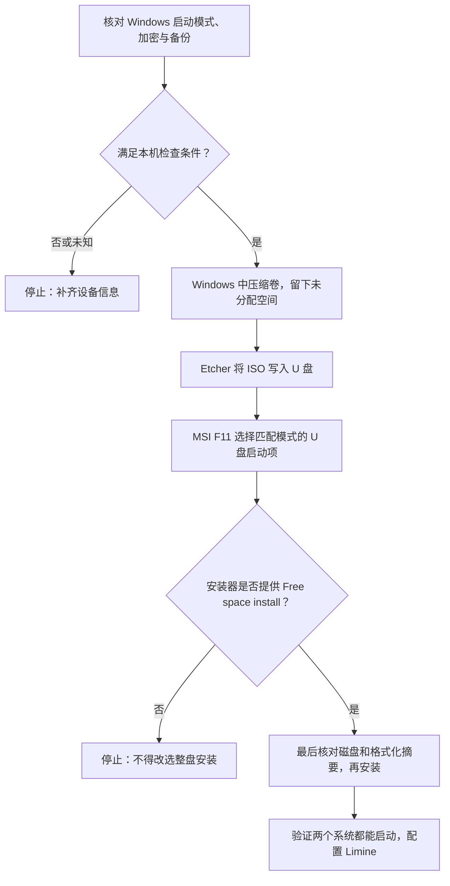

# Windows 10 与 Omarchy 双系统：MSI MS-1759 安装 U 盘、分区与启动指南

> [!danger] 先看停止条件
> **此文是操作指导，不表示本机已经完成检查或安装。** 安装器中必须选择 **Free space install（空闲空间安装）**，而非 **Full-disk install（整盘安装）**；后者会清空所选磁盘。尚未查明 Windows 的「BIOS 模式」、实际磁盘布局和显卡型号时，**先停在准备阶段，不要调整固件启动模式或确认安装格式化**。安装之前先做独立备份并验证能读回。[1][2]

## 一、当前已知信息与决策门槛

- 用户设备：**Windows 10 笔记本；机身编号 MSI MS-1759；Omarchy ISO 文件已在 Windows 中**。
- 用户在前述第 3 项答复「已关闭」：按提问顺序理解为 **BitLocker／设备加密已关闭（用户报告，未在设备上核验）**。Windows Home 也可能有设备加密，务必核对实际状态；若仍显示正在解密，应等完成再继续。[2][4]
- **未知且不可推断**：Windows「BIOS 模式」是 UEFI 还是传统、分区表 GPT/MBR、精确产品型号、集成／独立显卡、内部磁盘数量与可用空间、ISO 版本及校验状态、是否保有 Windows 恢复介质和恢复密钥。
- MS-1759 可能对应 GE70 系列的多种子型号：例如 MSI 官方规格页中 GE70 2PC 配 GTX 850M，GE70 2PE 配 GTX 860M。**这不是本机显卡识别结果，更不能据此宣称最新 Omarchy 支持该设备。**旧款 NVIDIA 的 Linux 驱动适配有过项目问题报告；该 issue 已关闭，也不能据此保证具体 ISO 和硬件组合正常。[8][9][10]

| 核对项 | 在 Windows 10 中如何只读查看 | 放行原则 |
| --- | --- | --- |
| 系统型号、BIOS 模式、安全启动状态 | `Win + R` → `msinfo32` →「系统摘要」 | **UEFI**：继续核对磁盘与显卡；**传统/Legacy**：先停止这份 UEFI 安装流程，别直接在 BIOS 中切换为 UEFI。启动模式与现有 Windows 安装不匹配可能使 Windows 无法启动。[6] |
| 显卡 | 设备管理器 →「显示适配器」；记录全部显卡名称 | 老 NVIDIA／混合显卡先测试安装介质能否正常启动；即使能进入安装环境，也不代表安装后驱动、桌面、休眠与外接屏可用。[8][9][10] |
| 加密 | 搜索「管理 BitLocker」；适用时查看 Windows「设置 → 更新和安全 → 设备加密」 | 确认系统盘没有仍在加密或解密；官方双系统路径要求先关闭 BitLocker。不要把「暂停保护」误当作已解密。[2][4] |
| 目标盘与空闲空间 | `Win + X` →「磁盘管理」；记录磁盘号、容量、分区布局、磁盘属性里的分区样式 | 核实同一目标盘上有可压缩的 Windows 分区；区分 SSD、HDD 和外接 U 盘，**只在确认的目标盘操作**。[2][5] |

> [!warning] 请先回传的信息
> 安装前先把 `msinfo32` 的 **系统型号、BIOS 模式、安全启动状态**、设备管理器里的**显卡名称**及磁盘管理的**磁盘容量／布局**发来；可用文字描述，不要分享序列号、恢复密钥或个人文件。若显示「传统」，本文后续安装步骤暂不适用，须另行评估引导模式和备份／迁移方案。

## 二、先弄懂三种「盘」，避免选错

**安装 U 盘**只用于启动安装环境，写入 ISO 时会清空 U 盘；**Windows 所在内部盘**承载现有系统和数据；**未分配空间**是从 Windows 分区压缩出来、留给 Omarchy 安装器使用的区域。U 盘容量、内部磁盘容量、可缩小空间三者不能混淆。[1][2][5]

读图要点：**启动 U 盘不是安装目标盘**；条件检查、未分配空间以及最后确认是三个独立的保护闸门。图中的“放行”须在真实设备上检查，不能用本指南的存在代替。[1][2]

## 三、步骤 0：备份和启动条件（操作前）

1. 将 Windows 个人文件备份到**不同物理设备**；实际打开几个备份文件确认可读。保存 Windows 恢复环境／恢复介质；如果过去启用过加密，保管恢复密钥。组织管理设备先咨询管理员。
2. 用 `msinfo32` 核对当前启动模式；**不要仅为让 USB 出现而把原 Windows 从 Legacy/CSM 改为 UEFI**，也不要重置 BIOS 或清空 TPM。若是 Legacy，先停止并单独规划 Windows 的引导／磁盘迁移。[6]
3. 核对安全启动（Secure Boot）状态。Omarchy 入门手册要求关闭 Secure Boot 和／或 TPM 才能安装；具体改动以当前设备固件和安装提示为准，记录改动前状态。固件安全设置变化可能影响 Windows 恢复／解锁；先完成备份和加密核对。**无需为满足一行手册文字而盲目清空 TPM。**[1][4]
4. 确定 ISO 版本和文件来源；从官网拿到对应版本校验信息再验证完整性，旧版本 SHA-256 不能用于新镜像。插电操作，备有线或 2.4 GHz 无线接收器键盘，以免默认 LUKS 加密的开机解锁依赖蓝牙键盘。[1][11]

## 四、步骤 1：在 Windows 中留出 Omarchy 的未分配空间

1. 在 `Win + X → 磁盘管理`中识别 Windows 系统盘，记下**磁盘编号与容量**。如果同时存在小 SSD 和大 HDD，先决定要在哪块盘安装，并确保之后安装器中选择**同一块**。[2][5]
2. 右键可缩小的 Windows 数据分区（通常为 C:，但先核对），选「压缩卷」。输入计划给 Omarchy 的容量，确认后应出现**未分配**区域。官方页面用 50 GB 作为图示，**不是官方统一最低门槛**；该空间还要容纳 Omarchy 启动区域、系统、更新及个人数据。留多少取决于真实磁盘容量和使用需求。[2]
3. **不要**删除/格式化 Windows、EFI、恢复分区；**不要**把新出现的未分配区域在 Windows 里创建成 NTFS 新卷。记录压缩前后磁盘布局，确认 Windows 仍能正常重启。[2][5]
4. 如果磁盘管理无法压缩到所需容量、空间布局不清楚、存在动态磁盘／多磁盘／既有其他引导项，**停止**，不要改用删除分区等高风险办法“凑空间”。

## 五、步骤 2：将已有 ISO 写成安装 U 盘

1. 确认 U 盘数据已备份；连接 U 盘并记下它的容量、型号。在 Windows 安装 [balenaEtcher 官方版](https://etcher.balena.io/)。Omarchy 手册明确推荐 Windows/macOS 用 balenaEtcher。[1][7]
2. 在 Etcher 中依次选择 **Flash from file → 已有 Omarchy `.iso`**、**Select target → 仅选核对过的 U 盘**、**Flash**。等待写入和工具提供的校验完成，再安全弹出。
3. 直接把 ISO 作为文件复制到 U 盘**不能代替写入镜像**；Windows 写入后若弹出“需要格式化此驱动器”的提示，**不要点格式化**，先核对写盘工具报告及设备是否能从 U 盘启动。

## 六、步骤 3：在 MSI 上启动 U 盘并安装

1. 插上电源和启动 U 盘，重启时在 MSI 标志出现时连续按 **F11** 进入一次性 Boot Menu。MSI 的笔记本资料给出 F11；若本机按键无效，以该机实际固件说明为准。**Delete** 是进入 MSI 笔记本 BIOS 设置的常用按键，不等于要常驻修改启动优先级。[12][13]
2. 如果 Windows 当前是 UEFI，优先选与之匹配的 **UEFI U 盘启动项**；若找不到，先回到 Windows 查 ISO 写入结果和设备模式，**不要切换成 Legacy 来绕过**。若 Windows 是传统模式，停止本指南的后续流程。[6]
3. 进入 Omarchy 安装器后确认硬盘号／容量与 Windows 里记下的一致。选择 **Free space install**，由安装器使用未分配空间；该路径默认启用 **LUKS 加密**。选择整盘安装将清空整块目标盘。[1][2]
4. 在最终确认页逐项看目标盘、将被修改/格式化的区域、加密选择。找不到空闲空间安装选项、摘要显示删除 Windows/全盘擦除、磁盘号不确定或所选区域不是预留空间：**取消安装**，不要按确认。
5. 设定并安全保存 Omarchy 的磁盘解锁口令；安装结束后拔掉 U 盘重启。记录安装器提示和实际启动结果，不假设每个版本的界面与截图相同。[1][2]

## 七、开机时如何选择 Windows 或 Omarchy

- 安装后 Omarchy 官方说明通常会以 **Limine** 作为默认引导器；在能够正常进入 Omarchy 的前提下，于 Omarchy 终端运行 `limine-scan`，按提示把 **Windows Boot Manager** 加进 Limine 配置，重启后在引导菜单选择系统。[2]
- 即使 Limine 暂时没有 Windows 条目，也可尝试启动时按 **F11** 调出 MSI 一次性启动菜单，选择 **Windows Boot Manager** 或 Omarchy 对应启动项；具体显示依固件和磁盘布局变化。不要把“菜单暂时没显示 Windows”直接等同于 Windows 数据被删。[2][12]
- Windows Boot Manager 也找不到、Windows 无法启动、Omarchy 卡在显卡/解锁阶段时，**停止进一步写盘或反复修复分区**，回到安装记录、备份和固件启动项排查；不要在不了解引导结构前运行通用 boot repair 命令。

## 八、完成验收与常见失败路径

| 观察 | 可以做的最小检查 | 不应做的事 |
| --- | --- | --- |
| F11 没有 U 盘 | 换 USB 接口，核对写入校验、ISO 来源、UEFI/Legacy 模式 | 不要直接把内置盘格式化或随意改 Windows 原启动模式 |
| 安装器没看到 Free space install | 回 Windows 核对同一磁盘是否真有足量未分配空间 | 不要改选 Full-disk install |
| 安装器提示 BitLocker 未关闭 | 退出，回 Windows 查当前系统盘加密状态并等待解密完成 | 不要依赖「暂停保护」蒙混通过 |
| Omarchy 黑屏或桌面异常 | 记录 ISO 版本与真实 Intel/NVIDIA 显卡，核对当前项目驱动支持与日志 | 不要把“U 盘能启动”当作硬件完全兼容；不要盲装旧驱动 |
| 只有一个系统能启动 | 先通过 F11 查看各启动项；有 Omarchy 时按官方 `limine-scan` 方式加入 Windows | 不要清空 EFI/Windows 恢复分区或尝试未经验证的分区修复 |

**验收清单**：Windows 原有文件可访问；Omarchy 可解锁并登录；重启两次都能稳定选择目标系统；Wi-Fi、有线网络、声音、键盘/触控板、亮度、外接显示器、睡眠唤醒逐项检查。**系统快照不是 Windows 或 `/home` 数据的替代备份**，留好独立备份；尚未通过验证前不要迁移唯一一份重要数据。[14]

## 九、证据与边界

- 事实：官方手册支持使用 Windows 中压缩卷所得**未分配空间**做 Free space install，并提供 `limine-scan` 添加 Windows 的流程；本指南引用的是**在线手册**，ISO 版本可能不同。[1][2]
- 事实：MSI 官方 GE70 不同产品规格表有 GTX 850M/860M 的差异；**MS-1759 编号本身不足以确定本机是哪一款**。[8][9]
- 已知风险但非结论：Omarchy 项目曾有旧 NVIDIA 驱动问题，关联 issue 已关闭；**不能据此断言具体 MSI 设备无法用，亦不能保证已适配**。[10]
- 用户报告（未经设备检查）：Windows 10、MS-1759、已有 ISO、前述第 3 项「已关闭」。此处不记录设备唯一识别码、Windows 恢复密钥或任何凭据。
- 本文未写入启动 U 盘、未接触 MSI 机器、未验证 ISO 哈希/磁盘布局/显卡、未在 Obsidian 图形界面检查渲染；所述命令是**之后由设备所有者按条件执行的指导**，不是已运行记录。

## 来源（核对日：2026-10-10）

1. [Omarchy Getting Started：安装介质、整盘与空闲空间、加密与固件要求](https://omarchy.org/manual/getting-started/)
2. [Omarchy Dual Boot Install：Windows 压缩卷、Free space install、BitLocker 与 Limine](https://omarchy.org/manual/dual-boot-install/)
3. [[Omarchy Linux：架构亮点、安装要求与最佳实践|已有 Omarchy 架构与安装要求笔记]]（同库背景资料，非独立外部证据）
4. [Microsoft：Device Encryption in Windows（适用于 Windows 10）](https://support.microsoft.com/en-us/windows/security/encryption/device-encryption-in-windows)
5. [Microsoft：Disk Management in Windows（适用于 Windows 10）](https://support.microsoft.com/en-us/windows/experience/storage-filemanagement/disk-management-in-windows)
6. [Microsoft：MBR2GPT（仅用于说明启动模式迁移需另案规划，不是本文操作指令）](https://learn.microsoft.com/en-us/windows/deployment/mbr-to-gpt)
7. [balenaEtcher 官方站：OS 镜像写入工具](https://etcher.balena.io/)
8. [MSI：GE70 2PC Apache 规格](https://www.msi.com/Laptop/GE70-2PC-Apache/Specification)
9. [MSI：GE70 2PE Apache Pro 规格](https://www.msi.com/Laptop/GE70-2PE-Apache-Pro/Specification)
10. [Omarchy issue #3954：旧 NVIDIA 驱动风险报告（已关闭；不作为本机断言）](https://github.com/omacom/omarchy/issues/3954)
11. [Omarchy ISO 仓库与校验方式](https://github.com/omacom/omarchy-iso)
12. [MSI：笔记本 F11 Boot Menu 说明（PDF）](https://storage-asset.msi.com/files/pdf/How_to_make_a_bootable_flash_disk_and_to_flash_BIOS_en.pdf)
13. [MSI：笔记本 Delete 进入 BIOS 的说明](https://us.msi.com/support/technical_details/NB_BIOS_Boot_Order)
14. [Omarchy：System snapshots（不覆盖 `/home`）](https://omarchy.org/manual/system-snapshots/)
