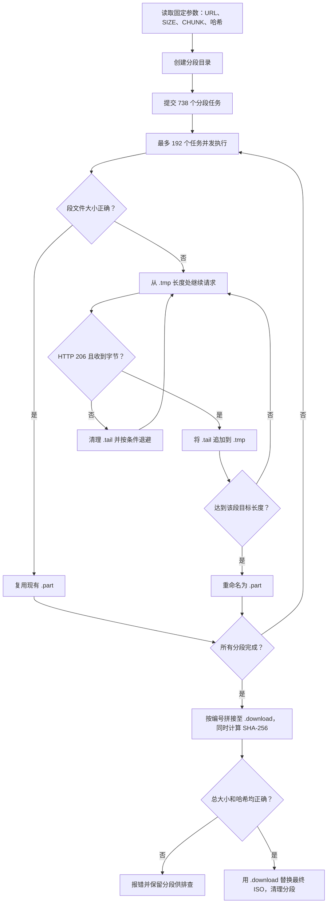

# download_omarchy.py：大文件分段下载、断点续传与完整性校验

> [!abstract] 核心思路
> 把约 5.76 GiB 的 ISO 按固定字节区间切成 738 段；每段独立请求、落盘和续传。全部分段完成后，按序拼接并同时计算 SHA-256。只有大小和官方哈希都正确，才把临时成品替换成最终 ISO。脚本是这次下载任务的专用实现，参数和路径均写死在文件中。

**实际脚本**：`/Users/czn/agent-workingspace/download_omarchy.py`  
**最终镜像**：`/Users/czn/agent-workingspace/omarchy-4.0.4.iso`  
**原始来源**：[Omarchy 4.0.4 发布页](https://github.com/omacom/omarchy/releases/tag/v4.0.4)及其指向的 `https://iso.omarchy.org/omarchy-4.0.4.iso`。

## 一、为什么要设计这套策略

目标是把一个 6,185,304,064 字节的 ISO 可靠地下载到本地。当时服务器响应 `Accept-Ranges: bytes`，意味着客户端可以只请求某段字节。磁盘可用空间充足，但当前网络路径的单连接吞吐较低，连接也可能中途超时。

最先试用 aria2：16 条连接时约 0.6 MiB/s；该工具的 `--max-connection-per-server` 上限就是 16。于是改用多个独立的 `curl` 进程请求互不重叠的字节区间。脚本先用了 96 个并发任务，后来调到 192 个。这个数字只是当时的调优选择；最终日志中的 `0.68 MiB/s average` 是**已完成分段字节数除以本次进程运行时间**，并不等于真实网络瞬时吞吐。期间还试过另一镜像和 HTTP/3，未得到更好的可用路径。

这里真正要解决的是两个问题：

1. **传输效率**：用并发掩盖高延迟或单连接限速。
2. **工作保存**：连接断掉时保留已收到的字节，避免从该段起点重下。

并发只能改善某些瓶颈。如果出口带宽或代理本身已饱和，继续增加连接可能更慢，也可能增加服务器压力。因此 `WORKERS = 192` 不应被理解成通用最佳值。

## 二、先建立字节模型

脚本将总长 `SIZE = 6_185_304_064` 按 `CHUNK = 8 * 1024 * 1024`，即每段 8 MiB，切为：

```text
总长度 SIZE = 6,185,304,064 字节
标准段长 CHUNK = 8,388,608 字节
分段数 count = ceil(SIZE / CHUNK) = 738

段 0000: [0,             8,388,607]      8 MiB
段 0001: [8,388,608,    16,777,215]      8 MiB
   ...
段 0737: [6,182,404,096, 6,185,304,063] 2,899,968 字节
```

第 `i` 段的计算式是：

```python
start = i * CHUNK
end = min(start + CHUNK, SIZE) - 1
expected_size = end - start + 1
```

HTTP `Range: bytes=start-end` 两端都包含在内，所以 `end` 必须减 1。最后一段由 `min` 截断，避免请求越过文件结尾。各段恰好覆盖 `[0, SIZE - 1]`，相邻段不重叠、无空洞。正因为边界可计算，拼接时只需按编号顺序读取分段。

## 三、整体控制流



主程序 `main()` 负责分配任务、按序拼接、校验和发布最终文件；`fetch(index)` 只负责一个字节区间。这种职责划分使分段可以并发，而拼接仍保持确定的顺序。

## 四、四种文件状态分别做什么

| 路径或后缀 | 含义 | 中断后如何处理 |
|---|---|---|
| `0000.tail` | **本轮 HTTP 请求**收到的字节暂存 | 启动该段任务时删除；没有记录本轮请求起点，不能安全直接复用。 |
| `0000.tmp` | 该段从起点开始的连续前缀 | 读取文件长度，下一次从 `start + offset` 请求。 |
| `0000.part` | 达到该段预期长度的完整分段 | 下次运行先检查长度，符合则跳过网络请求。 |
| `omarchy-4.0.4.iso.download` | 按序拼接中的临时成品 | 只有完整哈希验证通过，才替换最终 `.iso`。 |

分段放在 `.omarchy-4.0.4.parts/` 中。`0000` 等四位编号保证文件名可读，但拼接并不依赖目录排序，而是显式按 `range(count)` 顺序读取。

初版脚本在超时后删除整个 `.tmp`，使慢连接已经下载的几 MiB 白费。后续改成上面的两级暂存：`.tail` 接收本次请求，确认服务器返回 `206 Partial Content` 后再追加到 `.tmp`。这个修改直接解决了超时重下的问题。

## 五、`fetch(index)` 如何断点续传

每段开始先检查 `.part` 的长度。长度恰好正确就返回；否则读取 `.tmp` 当前长度 `offset`，发出范围请求：

```text
原始段范围：     [start, end]
已保存前缀：     [start, start + offset - 1]
本轮请求范围：   [start + offset, end]
```

例如第 0 段已有 `3,145,728` 字节，则下次请求 `Range: bytes=3145728-8388607`。服务器的 `206` 响应体写入 `.tail`。即使 `curl` 因 180 秒总时限而以非零状态退出，只要已收到的响应标记为 `206`，脚本仍会把 `.tail` 中的字节追加到 `.tmp`，下轮从新的偏移继续。

请求由 Python 线程启动 `curl` 子进程。几个参数各有作用：

| 参数 | 作用 |
|---|---|
| `--range start-end` | 只要指定的字节区间。 |
| `--location` | 跟随服务器重定向。 |
| `--fail` | 对 HTTP 错误返回失败状态。 |
| `--connect-timeout 20` | 连接阶段最多等待 20 秒。 |
| `--max-time 180` | 每次请求最长运行 180 秒；超时后可保留已收到的有效字节。 |
| `--write-out %{http_code}` | 将 HTTP 状态码送回 Python，区分 `206` 与其他响应。 |

达到 `expected_size` 后，`.tmp` 被重命名为 `.part`。超过目标长度则报错，防止字节溢出污染相邻段。一个分段最多尝试 30 轮；非 `206` 的失败会短暂退避。某段始终失败时，程序退出并保留已完成分段，下次可以续跑。

> [!warning] 续传的信任边界
> 当前代码只检查状态码 `206` 和长度，没有逐次验证 `Content-Range`、`ETag` 或每段哈希。因此长度正确的 `.part` 只能称作“传输完成”，还不能称作“内容正确”。最终整文件 SHA-256 才是内容完整性的判定依据。若中途换源或远端文件被替换，最后会因哈希不符而拒绝发布。

## 六、并发模型与进度数字

`ThreadPoolExecutor(max_workers=192)` 最多同时运行 192 个 `fetch`。每个运行中的 `fetch` 同步等待一个 `curl` 子进程，所以主要工作是网络 I/O，Python 线程不负责解析或复制大量响应体。`as_completed(futures)` 在每段完成时回收结果。

这个实现的资源成本是同时存在大量 TCP 连接、`curl` 进程、文件描述符和临时文件。它能在单连接很慢时提高总吞吐，但并发数太高会增加连接建立与重试成本。实际调优应以**稳定的有效字节/秒**衡量，而不是连接数。

日志中的进度只把已完成的 `.part` 计入 `done`。正在写入的 `.tmp` 和 `.tail` 没算进去，因此下载时出现过“完整分段约 77%，目录却已接收约 5.5 GiB”的现象。进程重启后，显示的平均速度也会重新计时，不能拿它直接比较两次运行的网络性能。

## 七、拼接、哈希和最终发布

所有 `fetch` 返回后，`main()` 按分段编号顺序把每段复制到 `.iso.download`。每读取 1 MiB，就同时执行 `digest.update(block)` 和 `output.write(block)`；无需再为**拼接阶段**额外扫描一次所有分段。

然后执行两项门槛检查：

1. 拼接文件的 SHA-256 必须等于官方发布页给出的 `ddeded2758c48318d201dfdac905ecb28f570441883f0c052ea3cd5d05acf92d`。
2. 拼接文件大小必须为 `6,185,304,064` 字节。

通过后，`OUTPUT.replace(TARGET)` 在同一文件系统内把临时成品替换为 `omarchy-4.0.4.iso`，最后清理分段目录和之前 aria2 的控制文件。若校验失败，代码在替换目标前抛错，分段与 `.download` 留在本地供排查。`replace` 提供文件名层面的原子替换；这段代码没有调用 `fsync`，不承诺断电情况下的持久化语义。

此次完成后，还对**最终落盘的 ISO** 独立运行了 `shasum -a 256`。结果与拼接时的哈希和官方发布页一致，最终文件大小也重新由 `stat` 确认。

## 八、失败模式与工程取舍

| 场景 | 当前处理 | 边界或代价 |
|---|---|---|
| 单次请求超时 | 保留 `206` 已接收的字节，下一轮按 `.tmp` 长度续传。 | 本轮 `.tail` 在进程被强制结束时可能丢失。 |
| HTTP 错误或不支持 Range | 不追加响应体，重试或最终报错。 | 只看 `206`，没有检查完整的 `Content-Range`。 |
| 某段长度异常 | 报错，停止最终发布。 | 无自动定位和修复已写错内容的段。 |
| 进程重启 | 复用长度正确的 `.part` 和 `.tmp` 连续前缀。 | 仅按长度复用，段内正确性仍靠整文件哈希。 |
| 源内容发生变化 | 整文件哈希不符，不发布。 | 需要重新定位受影响分段；脚本没有 `If-Range` 或版本锁定。 |
| 磁盘写满 | 系统写入报错，最终 ISO 不会发布。 | 未做运行中剩余空间监控。 |
| 并发过高 | 可修改 `WORKERS` 后重启，已完成分段继续复用。 | 过高并发可能让代理、服务器或本机成为瓶颈。 |

值得继续改进的地方是：从官方 `.sha256` 文件动态读取预期哈希；对每个响应校验 `Content-Range` 与固定的 `ETag`；用分段哈希或清单快速定位错误段；对 `.tail` 记录请求起点以便异常退出后复用；把 `URL`、路径、并发数与超时改成命令行参数；按 `.part + .tmp + .tail` 的实际字节数报告进度；使用受控关闭和更明确的磁盘空间检查。这些都是**未来改进方向**，不属于当前脚本已实现的功能。

## 九、如何复现与确认结果

脚本是特定版本的一次性下载器，运行前应先看清文件顶部的常量，尤其是 `ROOT`、`TARGET`、`SIZE` 和 `EXPECTED`。已经得到通过校验的 ISO 后，无需再运行脚本；重新运行会重新构建分段。

```bash
python3 /Users/czn/agent-workingspace/download_omarchy.py
stat -f '%N %z bytes' /Users/czn/agent-workingspace/omarchy-4.0.4.iso
shasum -a 256 /Users/czn/agent-workingspace/omarchy-4.0.4.iso
```

本次实测最终大小为 `6,185,304,064` 字节，独立重算的 SHA-256 为 `ddeded2758c48318d201dfdac905ecb28f570441883f0c052ea3cd5d05acf92d`。

## 相关笔记

- [[Windows 10 与 Omarchy 双系统：MSI MS-1759 安装 U 盘、分区与启动指南]]
