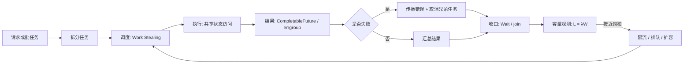
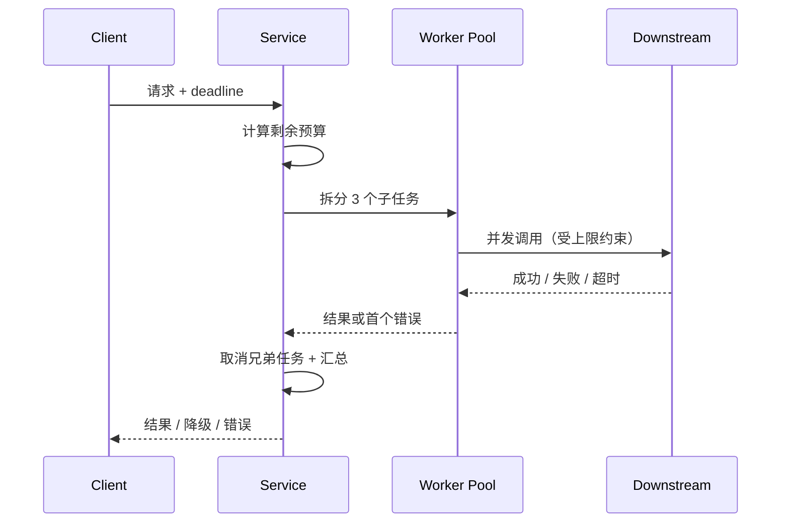

# 并发执行、失败传播与容量判断：五项机制的深度讲解

并发不是“把任务放出去”就结束了。一个任务从进入系统到退出，至少要回答五个问题：

1. **谁来执行，忙闲如何均衡？**
2. **多个执行者读写共享状态时，原子性、可见性和顺序如何保证？**
3. **异步阶段失败后，错误如何沿结果链传播，什么时候恢复，什么时候继续上抛？**
4. **一组子任务如何共同失败、共同取消、共同等待收口？**
5. **系统当前能承载多少在途工作，瓶颈到底在并发数、排队，还是下游延迟？**

本文围绕 [[tech-knowledge/算法小报-2026-09-19至2026-10-19]] 第三组的五项内容展开：**CompletableFuture、Work Stealing、VarHandle、Little's Law、errgroup**。它们分别落在调度、共享状态、异步结果、任务生命周期和容量判断五个控制点上。把它们放在同一条生命周期里看，比单独背诵五个名词更有价值。

> [!abstract] 一句话版本
> - **CompletableFuture**：异常是 Future 的一种完成状态；兜底、观测和继续上抛要分开设计，超时不等于取消。
> - **Work Stealing**：本地队列减少竞争，空闲 worker 从别处取任务；它适合 CPU 任务调度，不是限流器。
> - **VarHandle**：先定义线程间的 happens-before 协议，再选择 plain、opaque、acquire/release 或 volatile；单字段原子不等于多字段一致。
> - **Little's Law**：`L = λW` 是一本容量账，不是线程池公式；平均在途量必须配合尾延迟、利用率和余量一起看。
> - **errgroup**：首个错误触发取消，`Wait` 负责等待全部子任务退出；取消是协作式的，已经发生的副作用不会自动回滚。

> [!note] 与原始知识点的关系
> 本文扩展自算法小报第三组。原条目给出了方向、场景和边界；本文补充机制、代码、失败路径、观测指标和工程取舍。文中的代码是教学示意，不构成“某个实现一定更快”的性能承诺。涉及具体运行时行为时，应以所用 JDK、Go 版本和框架文档为准。

## 0. 先把五个机制放进同一条生命周期

把一次请求或一批任务拆开看，五个机制对应五个不同的控制点：

| 控制点 | 本文机制 | 回答的问题 | 缺失时的典型症状 |
|---|---|---|---|
| 调度 | Work Stealing | 哪个 worker 执行，如何减少全局竞争并保持负载均衡 | 全局队列争抢、部分线程空闲、尾任务拖长 |
| 共享状态 | VarHandle | 读写在什么语义下可见、有序、原子 | 丢更新、读到旧值、指令重排、ABA |
| 异步结果 | CompletableFuture | 成功值或异常如何沿阶段传播，如何恢复 | 外层 `try/catch` 抓不到、异常被吞、超时后仍在占连接 |
| 任务生命周期 | errgroup | 一组子任务如何一起失败、取消、等待 | goroutine 泄漏、只报错不停、提前返回留下后台任务 |
| 容量 | Little's Law | 吞吐、延迟和在途量之间是否自洽 | 线程池拍脑袋、队列无界、吞吐没涨延迟先炸 |

这五项不是互相替代的“算法候选”。一个系统可以同时使用它们：



下面逐项拆解。每一项都按“问题—机制—代码—边界—最佳实践”的顺序展开。

## 1. CompletableFuture：异常是 Future 的状态，不是线程的返回值

### 1.1 为什么外层的 `try/catch` 抓不到异步异常

先看一段很常见、但很容易误判的代码：

```java
try {
    CompletableFuture<String> future =
        CompletableFuture.supplyAsync(() -> callRemote());
    future.thenAccept(this::consume);
} catch (Exception e) {
    log.error("call failed", e);
}
```

这里的 `try/catch` 只能覆盖“提交任务”这个动作。`supplyAsync` 很快返回一个 `CompletableFuture`，真正的 `callRemote()` 可能在另一个线程、稍后甚至很久以后才执行。它抛出的异常不会重新抛回提交线程，而是把对应的 Future 标记为**异常完成**。

所以，异步链的错误处理必须进入链内：

```java
CompletableFuture<String> future = CompletableFuture
    .supplyAsync(() -> callRemote(), ioExecutor)
    .exceptionally(error -> {
        log.warn("remote call failed", unwrap(error));
        return "fallback";
    });
```

这不是 API 的“坑”，而是异步模型的必然结果：**调用线程已经离开了执行现场，异常只能附着在结果对象上。**

### 1.2 一个 Future 就是一台一次性状态机

可以把 `CompletableFuture<T>` 理解为一台只能完成一次的状态机：

```text
未完成
  ├── 成功: value = v
  ├── 失败: exception = e
  └── 取消: CancellationException
```

依赖它的阶段（`thenApply`、`thenCompose`、`whenComplete` 等）组成一张有向无环图。上游完成时，下游根据“成功还是异常”决定是否执行转换逻辑：

- 成功时，`thenApply` 会拿到值并继续；
- 失败时，普通的 `thenApply` 不会执行，异常继续向下游传播；
- 只有 `exceptionally`、`handle` 这类“异常通道”才有机会把失败转换成正常值；
- `whenComplete` 两条通道都能观察，但它默认不改变结果。

这就是理解 `CompletableFuture` 的主线：**先看这个阶段在成功通道还是异常通道上执行，再看它是否改变了完成状态。**

### 1.3 常用方法的语义对照

| 方法 | 成功时 | 失败时 | 是否改变完成状态 | 典型用途 |
|---|---|---|---|---|
| `thenApply` | 转换值 | 跳过，异常传播 | 否 | 纯内存转换、校验 |
| `thenCompose` | 返回并展平另一个 Future | 跳过，异常传播 | 否 | 串行依赖调用 |
| `thenCombine` | 合并两个结果 | 任一失败则异常传播 | 否 | 并行后合并 |
| `exceptionally` | 不执行 | 返回兜底值 | 是，可把失败变成功 | 局部降级 |
| `handle` | 执行并转换 | 执行并转换 | 是，可恢复也可继续失败 | 统一结果封装 |
| `whenComplete` | 观察结果 | 观察异常 | 默认否 | 记录日志、指标 |
| `allOf` | 等待全部完成 | 任一失败则整体异常 | 否 | 扇出后等待 |
| `anyOf` | 任一完成即返回 | 可能返回异常 | 否 | 竞速、冗余请求 |
| `orTimeout` | 超时后异常完成 | 超时后异常完成 | 是，标记超时 | 链级超时 |
| `completeOnTimeout` | 超时且尚未完成时给默认值 | 源已失败则保持失败；超时则给默认值 | 可能变为成功 | 可接受默认值的降级 |
| `cancel` | 标记取消 | 标记取消 | 是 | 调用方主动放弃 |

几个容易混淆的点：

- **`exceptionally` 只在失败时执行**，它接收异常并返回一个同类型的值；如果它自己再抛异常，结果仍然是失败。
- **`handle` 在成功和失败时都会执行**，它同时拿到结果和异常，适合把两种结果统一封装成 `Result`。
- **`whenComplete` 主要用于副作用**，例如打日志、记指标。它不负责“吞掉”异常；如果回调本身抛异常，返回的阶段会以回调异常完成。
- **`allOf` 不会自动取消其他任务**。它只是等待所有任务完成；某个任务失败后，其他任务可能仍在继续跑。
- **`anyOf` 返回的是 `Object`**，类型信息弱；如果第一个完成的是失败任务，整体也会失败，而且不会自动取消其余任务。

还有一个非常常见的组合错误：

```java
// 错：lambda 返回 Future，结果变成 CompletableFuture<CompletableFuture<Quote>>
CompletableFuture<CompletableFuture<Quote>> nested =
    loadUser(id).thenApply(user -> loadQuote(user));

// 对：用 thenCompose 展平异步依赖
CompletableFuture<Quote> flat =
    loadUser(id).thenCompose(user -> loadQuote(user));
```

`thenApply` 适合“同步转换”，`thenCompose` 适合“下一步本身也是异步调用”。如果需要在异常通道里发起另一个异步恢复操作，可以使用 `exceptionallyCompose`（较新 JDK）或让 `handle` 返回一个新的 `CompletionStage`，不要在异常回调里做阻塞等待。

### 1.4 观测、恢复、继续上抛：三种不同的错误策略

错误处理最需要先问清楚：**调用方是否应该知道这次失败？**

#### 策略 A：观测后继续上抛

```java
CompletableFuture<Quote> future = loadQuote(symbol)
    .whenComplete((quote, error) -> {
        if (error != null) {
            metrics.counter("quote.failure").increment();
        }
    });
```

`whenComplete` 记录指标，但不改变异常。调用方最终仍会收到失败。这适合“失败必须让上层知道”的场景。

#### 策略 B：局部降级，调用方看到兜底值

```java
CompletableFuture<Quote> future = loadQuote(symbol)
    .exceptionally(error -> {
        log.warn("quote fallback, symbol={}", symbol, unwrap(error));
        return Quote.fallback(symbol);
    });
```

这会把失败转换成成功。调用方无法再从 Future 上感知原始异常，因此必须确认业务是否允许“静默降级”。如果降级值可能引发错误决策，应该改为返回一个带失败标记的结果对象。

#### 策略 C：统一封装，但仍保留失败信息

```java
CompletableFuture<Result<Quote>> future = loadQuote(symbol)
    .handle((quote, error) -> {
        if (error != null) {
            return Result.failed(unwrap(error));
        }
        return Result.ok(quote);
    });
```

`handle` 把成功和失败都收束到同一个返回类型，既能让调用方继续走正常流程，又不会丢失失败信息。这是业务系统里经常更安全的选择。

### 1.5 超时、取消与真实 deadline

`orTimeout` 的语义是：如果在指定时间内没有完成，就把这个 Future 异常完成为 `TimeoutException`。

```java
CompletableFuture<Quote> future = CompletableFuture
    .supplyAsync(() -> quoteClient.get(symbol), ioExecutor)
    .orTimeout(remainingMillis(deadline), TimeUnit.MILLISECONDS);
```

关键边界是：**它只改变 Future 的完成状态，不保证底层 HTTP 请求、数据库查询或线程已经停止。**

假设 `quoteClient.get` 是一个阻塞调用，`orTimeout` 触发后：

- 调用方会收到超时；
- `quoteClient.get` 可能仍占用一个连接和线程；
- 它稍后返回时，结果会被丢弃，因为 Future 已经完成。

因此，生产环境至少要做三件事：

1. **把 deadline 传给真正的 I/O 客户端**，例如 HTTP 请求超时、RPC deadline、数据库 statement timeout；
2. **在链上设置一个不超过总预算的超时**，避免多个阶段各自设置超时后总和超出调用方预算；
3. **需要时使用可取消的底层 Future 或取消令牌**，而不是只依赖 `CompletableFuture.cancel`。

`CompletableFuture.cancel(true)` 的 `mayInterruptIfRunning` 参数并不会自动中断底层任务。它主要是把 Future 标记为取消；如果底层任务不检查中断或取消信号，它仍会继续执行。

一个更稳妥的 deadline 写法是：

```java
long remaining = deadline - System.nanoTime();
if (remaining <= 0) {
    return CompletableFuture.failedFuture(new TimeoutException("deadline exceeded"));
}

CompletableFuture<Quote> future = CompletableFuture
    .supplyAsync(() -> quoteClient.get(symbol, Duration.ofNanos(remaining)), ioExecutor)
    .orTimeout(remaining, TimeUnit.NANOSECONDS);
```

这里的关键不是 API 组合，而是**同一个 deadline 贯穿调用链**。如果每一层都用自己的 1 秒超时，三层串行就可能变成 3 秒；调用方早已放弃，后台还在工作。

### 1.6 线程池、上下文与死锁

`CompletableFuture` 的 `*Async` 方法如果没有指定 executor，通常使用 `ForkJoinPool.commonPool()`。这对短小的 CPU 任务很方便，但不适合大量阻塞 I/O：

- 公共池的线程数有限；
- 阻塞调用会占住线程；
- 其他依赖公共池的任务可能被拖住；
- 并行流、其他异步任务也可能共享这个池。

工程上更常见的选择是：

- **CPU 型任务**：有界、接近核数的池；
- **I/O 型任务**：独立的有界池，配合真实客户端超时；
- **不要让 callback 在完成线程上做长时间阻塞工作**；
- **不要在一个有界池的 stage 里 `join` 另一个依赖同一个池的 stage**，这会造成池内死锁。

另外，ThreadLocal、MDC、trace context、安全上下文不会自动跨异步边界传播。需要在提交任务时显式包装：

```java
Executor tracedExecutor = command -> {
    Map<String, String> context = MDC.getCopyOfContextMap();
    ioExecutor.execute(() -> {
        Map<String, String> previous = MDC.getCopyOfContextMap();
        if (context != null) {
            MDC.setContextMap(context);
        }
        try {
            command.run();
        } finally {
            if (previous != null) {
                MDC.setContextMap(previous);
            } else {
                MDC.clear();
            }
        }
    });
};
```

### 1.7 CompletableFuture 的最佳实践

- **错误处理放在链内**，不要指望外层 `try/catch` 捕获异步阶段异常。
- **先决定“恢复还是上抛”**：`exceptionally`/`handle` 会改变调用方对失败的感知。
- **`whenComplete` 只做观测**，不要把它当成兜底。
- **超时不是取消**：链上超时必须配合底层客户端 timeout/cancel。
- **统一 deadline**，不要层层叠加独立超时。
- **区分 `get()` 与 `join()` 的异常包装**：前者常见 `ExecutionException`，后者常见 `CompletionException`，需要时统一解包。
- **为阻塞 I/O 使用专用有界 executor**，不要默认依赖 commonPool。
- **控制扇出规模**：`allOf` 一次挂几千个任务，可能耗尽连接和内存。
- **传播追踪上下文**，否则日志和链路追踪会在异步边界断开。
- **测试失败路径**：超时、取消、部分成功、回调抛异常，都要有测试。

> [!question] 自测
> 调用方已经收到 fallback 时，远端调用是否还在占连接？如果会，你准备用哪一层 timeout 或取消机制把它真正停下来？

## 2. Work Stealing：把竞争从全局队列移到局部双端队列

### 2.1 全局队列为什么会成为瓶颈

最直观的线程池模型是“所有 worker 从同一个队列取任务”：

```text
             ┌──────────────┐
worker 0 ───▶│              │
worker 1 ───▶│  全局任务队列  │───▶ 取任务
worker 2 ───▶│              │
             └──────────────┘
```

任务少时没有问题；任务很多、worker 很多时，会出现三类成本：

1. **锁或 CAS 竞争**：所有 worker 同时修改队列头；
2. **缓存局部性差**：任务和它产生的子任务可能被不同 CPU 取走；
3. **负载不均**：某个 worker 取到长任务，其他 worker 只能等。

Work Stealing 的思路是：**每个 worker 先管好自己的本地队列，空闲时再去“偷”别人的任务。**

### 2.2 本地 LIFO，远端 FIFO

典型的 work-stealing deque 有两个端点：

```text
owner push/pop  <── [ 新 | 新 | ... | 旧 ] <── thief steal
                      本地端                远端
```

- **owner 从本地端 push/pop，通常是 LIFO**：最近产生的子任务最可能在缓存中仍然热，先做它有利于局部性；
- **thief 从远端 steal，通常是 FIFO**：拿走最旧的任务，通常粒度更大、剩余工作更多，能减少频繁窃取；
- 两端操作减少 owner 与 thief 的直接冲突。

这是一种“**局部优先、全局兜底**”的调度策略：正常情况下没有全局竞争，只有空闲 worker 才去别处找活。

### 2.3 ForkJoinPool：分治任务的典型实现

Java 的 `ForkJoinPool` 是 work stealing 的经典实现。一个简化的分治求和：

```java
class SumTask extends RecursiveTask<Long> {
    private static final int THRESHOLD = 10_000;
    private final long[] data;
    private final int from;
    private final int to;

    SumTask(long[] data, int from, int to) {
        this.data = data;
        this.from = from;
        this.to = to;
    }

    @Override
    protected Long compute() {
        if (to - from <= THRESHOLD) {
            long sum = 0;
            for (int i = from; i < to; i++) {
                sum += data[i];
            }
            return sum;
        }

        int mid = (from + to) >>> 1;
        SumTask left = new SumTask(data, from, mid);
        SumTask right = new SumTask(data, mid, to);

        left.fork();
        long rightResult = right.compute();
        long leftResult = left.join();
        return leftResult + rightResult;
    }
}
```

这段代码里有三个关键动作：

- `fork()` 把子任务放入当前 worker 的本地队列；
- `compute()` 在当前线程继续处理另一半；
- `join()` 等待另一个子任务，等待期间 worker 可以继续帮助执行其他任务。

`ForkJoinPool` 的并行度、公共池大小、任务窃取细节会随 JDK 版本和平台变化。工程上更重要的是理解它的适用边界：**它擅长大量可递归拆分的 CPU 任务，不擅长阻塞 I/O。**

### 2.4 Go GMP 的相似与不同

Go runtime 的调度器也使用 work stealing 思路：

- 每个 P（processor）有本地 run queue；
- 本地队列满时，任务可能进入全局队列；
- 空闲 P 会从其他 P 的队列偷任务，常见实现会一次偷一批（例如“偷一半”）；
- `runnext` 之类的槽位用于优先运行刚被唤醒的 goroutine。

但不要把 Java 的 deque 细节直接套到 Go 上：

- Go 的调度单位是 goroutine，不是 `ForkJoinTask`；
- 阻塞系统调用涉及 M（OS thread）与 P 的交接，work stealing 不能解决阻塞本身；
- 具体字段、阈值、偷取数量属于实现细节，会随版本演进。

共同的思想是：**本地队列负责快路径，跨 worker 偷取负责负载均衡。**

### 2.5 任务粒度：Work Stealing 最容易踩的坑

任务太粗：

- 某个 worker 拿到一个大任务，其他 worker 没活干；
- 尾延迟被最长任务拖住；
- 负载均衡失效。

任务太细：

- 调度、入队、窃取的成本超过实际计算；
- 队列操作和缓存失效放大；
- 递归层数过深，栈和对象分配变多。

一个实用的判断方法是：**先测量任务执行时间的分布，再决定是否拆分。** 如果单个任务只有几微秒，却要经过多次 fork/join，调度开销可能占主导；如果单个任务几十毫秒且极不均匀，适当拆分更可能改善尾延迟。

### 2.6 Work Stealing 不是限流器

这是最需要强调的边界：

- Work Stealing 的目标是**提高 CPU 利用率和负载均衡**；
- 它不会限制下游请求速率；
- 它不会自动保护数据库连接池；
- 它不会让阻塞 I/O 变快；
- 它不会自动处理失败和取消。

如果下游只能承受 100 QPS，增加 worker 或让空闲 worker 偷更多任务，只会更快地把下游打满。此时需要的是**信号量、令牌桶、bulkhead、队列上限和背压**，而不是更激进的调度。

### 2.7 失败、取消与观测

Work Stealing 只负责“怎么执行”，不负责“失败怎么办”。在 `ForkJoinPool` 中尤其要注意：

- 通过 `execute()` 提交的任务，异常可能不会自动传到调用方；
- 通过 `join()`/`get()` 等待时，才能观察到异常；
- `ForkJoinTask.cancel()` 是协作式的，已经运行的任务不保证立即停止；
- 未捕获异常可能导致 worker 线程异常退出，具体行为取决于池和异常处理器。

观测上，可以关注：

| 指标 | 说明 |
|---|---|
| 活跃线程数 / 并行度 | 池是否真正被利用 |
| 本地队列长度 | 任务是否堆积在某个 worker |
| steal 次数 | 负载不均或任务过细的信号之一 |
| 任务执行时间分布 | 判断粒度是否合适 |
| 队列等待时间 | 区分“执行慢”与“排队久” |
| CPU 利用率 | 判断是 CPU 饱和还是阻塞 |
| p95/p99 尾延迟 | 负载均衡是否真的改善了体验 |

`steal` 次数高不一定是坏事，它可能说明调度器正在积极均衡；但如果 steal 很多、任务又极短，可能说明任务拆得太碎。

### 2.8 Work Stealing 的最佳实践

- **只用于 CPU 型、可拆分任务**；阻塞 I/O 用独立的有界池或异步 I/O。
- **任务粒度要经过测量**，不要凭感觉无限递归拆分。
- **优先减少共享可变状态**，否则调度再快也会被锁和缓存一致性拖住。
- **不要把 work stealing 当限流器**；下游保护要用信号量、队列上限和背压。
- **等待任务时用 `join`/`get` 观察异常**，不要 fire-and-forget。
- **关注尾延迟和队列等待**，不要只看平均 CPU 利用率。
- **区分实现细节**：Java 的 ForkJoinPool 与 Go runtime 的调度器相似但不等同。

## 3. VarHandle：把“原子、可见、有序”拆开选择

### 3.1 它解决什么问题

Java 9 引入 `VarHandle`，为变量访问提供标准化的底层机制，主要替代过去依赖 `sun.misc.Unsafe` 的场景：

- 访问对象字段；
- 访问数组元素；
- 访问 `ByteBuffer` 中的位置；
- 执行 CAS、原子加减、按位操作；
- 选择不同的内存顺序语义。

它不是一个“更快的锁”，也不是“自动保证线程安全”的工具。它更像是一套**变量访问协议**：你可以精确指定“这次读写需要多强的原子性、可见性和顺序”。

一个基本用法：

```java
class Worker {
    private volatile int state;
    private static final VarHandle STATE;

    static {
        try {
            STATE = MethodHandles.lookup()
                .findVarHandle(Worker.class, "state", int.class);
        } catch (ReflectiveOperationException e) {
            throw new ExceptionInInitializerError(e);
        }
    }

    int state() {
        return (int) STATE.getVolatile(this);
    }

    boolean casState(int expected, int next) {
        return STATE.compareAndSet(this, expected, next);
    }
}
```

### 3.2 访问模式：从 plain 到 volatile

`VarHandle` 的核心价值在于访问模式的选择。可以用一张表建立直觉：

| 模式 | 典型方法 | 原子性 | 顺序/可见性 | 适用场景 |
|---|---|---|---|---|
| plain | `get` / `set` | 与普通字段访问相同 | 不提供跨线程顺序保证 | 单线程或已有外部同步 |
| opaque | `getOpaque` / `setOpaque` | 保证不会撕裂 | 不提供 acquire/release 顺序 | 进度计数、统计值等“只要原子、不要排序” |
| acquire/release | `getAcquire` / `setRelease` | 单次访问原子 | release 之前的写不会被排到 release 之后；acquire 之后的读不会被排到 acquire 之前 | 发布/消费、状态标志、无锁结构 |
| volatile | `getVolatile` / `setVolatile` | 单次访问原子 | 接近完整的内存屏障语义 | 需要强可见性和顺序的共享变量 |
| CAS | `compareAndSet` / `compareAndExchange` | 读—比较—写原子 | 通常具有 volatile 语义 | 无锁更新、状态机 |
| 原子读改写 | `getAndSet` / `getAndAdd` / 按位操作 | 单次 RMW 原子 | 通常具有 volatile 语义 | 计数器、位图、引用替换 |
| weak CAS | `weakCompareAndSet*` | 原子，但可能伪失败 | 取决于具体变体 | 可在循环中重试的高竞争场景 |

几个关键区别：

- **plain 不保证跨线程可见性**。用一个 plain 读写做“停止标志”，线程可能长时间看不到变化。
- **opaque 保证原子性和一致性，但不建立 acquire/release 关系**。它适合“我不在乎先后，只在乎不会读到半个值”的场景。
- **acquire/release 是一对协议**。写方用 release 发布，读方用 acquire 消费，二者配合才能建立 happens-before。
- **volatile 更强**，通常可以理解为同时具备 acquire 和 release 语义，并且 volatile 变量之间存在全局同步顺序。

> [!warning] 不要把“模式”当成性能开关
> 选择访问模式的依据是**正确性协议**，不是“哪个看起来更快”。如果协议需要 release/acquire，就不能为了省一点开销改成 plain。性能优化必须建立在正确性之上。

### 3.3 happens-before：发布与消费

最经典的 acquire/release 场景是“先准备数据，再发布标志”：

```java
class ConfigHolder {
    private Config config;
    private boolean ready;
    private static final VarHandle READY;
    private static final VarHandle CONFIG;

    static {
        try {
            MethodHandles.Lookup lookup = MethodHandles.lookup();
            READY = lookup.findVarHandle(ConfigHolder.class, "ready", boolean.class);
            CONFIG = lookup.findVarHandle(ConfigHolder.class, "config", Config.class);
        } catch (ReflectiveOperationException e) {
            throw new ExceptionInInitializerError(e);
        }
    }

    void publish(Config value) {
        CONFIG.set(this, value);
        READY.setRelease(this, true);
    }

    Config consume() {
        if (!(boolean) READY.getAcquire(this)) {
            return null;
        }
        return (Config) CONFIG.getAcquire(this);
    }
}
```

这里的顺序关系是：

```text
Thread A:  CONFIG = value
           READY.setRelease(true)
                 │
                 │  release 之前的写不会跑到 release 之后
                 ▼
Thread B:  READY.getAcquire() == true
           CONFIG 的读一定能看到 value
```

如果 `READY` 用 plain 写、plain 读，Thread B 可能看到 `ready == true`，却看到旧的 `config`，甚至看不到 `config` 的写入。原因不是“CPU 一定会乱序”，而是 Java 内存模型允许这种重排和可见性结果。

严格来说，`READY` 的 acquire 已经建立了后续读的可见性，因此 `CONFIG` 用普通读也可以；示例保留 `getAcquire` 是为了让“读方使用 acquire”这一侧协议显式可见。真正不能省的是：**写方在发布 `READY` 之前完成 `CONFIG` 的写，读方在读取 `CONFIG` 之前先 acquire `READY`。**

### 3.4 CAS 循环与 ABA

`VarHandle` 也常用于无锁状态机：

```java
boolean transition(int expected, int next) {
    return STATE.compareAndSet(this, expected, next);
}

int transitionWithRetry(int expected, int next) {
    while (true) {
        int current = (int) STATE.getVolatile(this);
        if (current != expected) {
            return current;
        }
        if (STATE.compareAndSet(this, current, next)) {
            return next;
        }
    }
}
```

CAS 只保证“比较和交换”这一步是原子的，不保证业务语义完整。典型问题包括：

- **ABA**：值从 A 变成 B 又变回 A，CAS 只看到 A，误以为没有变化；
- **活锁/饥饿**：高竞争下 CAS 反复失败，重试成本上升；
- **单字段局限**：CAS 保护了一个字段，却保护不了多个字段组成的不变量。

ABA 的解决方向不是“把 CAS 写得更复杂”，而是引入版本、引用快照或不可变对象：

```java
record Versioned<T>(T value, long version) {}
```

更新时比较 `(value, version)`，即使 value 回到旧值，version 也已经前进。

### 3.5 单字段原子 ≠ 多字段一致

这是 `VarHandle` 最常见的误用：

```java
private int x;
private int y;

void update(int nx, int ny) {
    X.setVolatile(this, nx);
    Y.setVolatile(this, ny);
}
```

两个字段各自是原子写，但“x 和 y 一起更新”并不是原子的。读线程可能看到新的 x 和旧的 y。如果业务不变量要求 `x == y`，这个实现就是错的。

可选方案：

- 用一把锁保护复合不变量；
- 把多个字段合并成一个不可变对象，用一次引用替换发布；
- 使用带版本号的快照，读方校验版本后重试；
- 重新设计数据布局，避免跨字段不变量。

`VarHandle` 能帮你精确控制单次访问，但不能替你定义事务边界。

### 3.6 常见错误清单

- **用 plain 读写共享标志**：没有可见性保证。
- **acquire 与 release 不配对**：写方用 release，读方却用 plain，协议不成立。
- **把 volatile 当锁**：volatile 保证单次读写可见性，不保证复合操作互斥。
- **忽略伪失败**：weak CAS 可能在没有冲突时也失败，必须放在重试循环里。
- **忽略访问模式支持范围**：不同 VarHandle 坐标（字段、数组、ByteBuffer）支持的模式可能不同，必要时检查 `isAccessModeSupported`。
- **忽略 false sharing**：两个高频写字段落在同一缓存行，会互相拖慢；VarHandle 不会自动解决。
- **忽略 long/double 的 plain 访问语义**：跨线程共享时，不要假设普通读写一定不会撕裂。
- **在热路径里反射查找 VarHandle**：应在静态初始化时解析一次并缓存。

### 3.7 VarHandle 的最佳实践

- **默认先用普通字段、`synchronized`、`Atomic*`、`LongAdder`**；只有确实需要特定内存语义或底层结构时再用 `VarHandle`。
- **先写清楚不变量和线程协议**：谁写、谁读、用什么模式、如何发布、如何回收。
- **把 VarHandle 封装在少数类里**，不要把它暴露成全局工具。
- **匹配访问模式**：release 配 acquire，volatile 配 volatile，CAS 用于读改写。
- **复合操作优先用锁或不可变快照**，不要用多个单字段原子操作拼事务。
- **用 JCStress 做并发正确性测试**，用 JMH 做性能测试；不要只靠代码审查。
- **关注 false sharing 和缓存行布局**，但先确认它真的是瓶颈。
- **把 ABA 当成协议问题处理**，加入版本或引用身份。

## 4. Little's Law：用 `L = λW` 做容量账本

### 4.1 公式与单位

Little's Law 的常见形式是：

$$
L = \lambda W
$$

其中：

- `L`：系统中平均有多少个元素（in-flight，在途）；
- `λ`：平均吞吐率（单位时间完成或离开的数量）；
- `W`：元素在系统中的平均停留时间。

单位必须一致：

```text
λ = 200 请求/秒
W = 0.08 秒
L = 200 × 0.08 = 16 个请求
```

这里的“系统”可以是一个线程池、一个连接池、一个服务、一条调用链，甚至整个集群。**边界定义不同，L、λ、W 的含义就不同。**

### 4.2 面积法直觉

想象一个系统里同时在途的请求数随时间变化：

```text
in-flight
  3 |       ██
  2 |   ████  ██
  1 | ██        ██
    +---------------- time
```

曲线下方的面积，等于“所有请求的停留时间之和”。如果统计窗口足够长，面积也近似等于：

```text
平均在途数 × 时间窗口 = 完成请求数 × 平均停留时间
```

两边除以时间窗口，就得到 `L = λW`。

这个推导说明了它的性质：**Little's Law 是一个在稳定系统中的恒等关系，不是某个排队模型的近似。** 它不假设泊松到达，也不假设服务时间分布；但它确实要求统计口径一致、系统处于稳定状态。

### 4.3 一个基线例子

假设服务每秒处理 200 个请求，平均每个请求在系统中停留 80ms：

```text
L = 200 × 0.08 = 16
```

平均有 16 个请求在途。这个数字可以继续拆：

- 如果 16 个都在执行，平均并发就是 16；
- 如果只有 10 个在执行、6 个在排队，那么线程/连接占用和队列长度要分开看；
- 如果 CPU 只有 4 核，16 个“在途”不代表 16 个并行执行，很多可能在等 I/O、锁或队列。

| 场景 | λ | W | L | 解释 |
|---|---:|---:|---:|---|
| 基线 | 200/s | 80ms | 16 | 平均在途 16 |
| 下游变慢 | 200/s | 160ms | 32 | 同样吞吐需要双倍在途 |
| 池子上限 16 | 200/s | >80ms | 16 + 队列 | 超出部分排队，W 继续上升 |
| 吞吐降到 150/s | 150/s | 200ms | 30 | 吞吐下降不代表系统空闲 |
| 请求泄漏 | 200/s | 持续增长 | 持续增长 | 系统不稳定，公式不能当容量结论 |

### 4.4 使用边界：五个必须对齐的口径

#### 边界一致

如果你在客户端测 `λ`，却在服务端测 `W`，得到的 `L` 没有意义。客户端 `W` 可能包含网络、重试和排队；服务端 `W` 可能只包含业务处理。

#### 稳定状态

`L = λW` 适用于稳定系统。若请求持续堆积、连接泄漏、任务只进不出，`L` 会随时间增长，不能用某个瞬间的平均值做容量承诺。

#### 到达与离开

严格来说，稳定状态下到达率等于离开率。如果系统正在丢弃请求或拒绝连接，`λ` 到底指“到达”还是“完成”必须写清楚；否则公式会掩盖失败。

#### 平均值的局限

`L` 是平均值，不是 p99。平均 16 个在途，不代表任何时刻都不会有 100 个在途。尾延迟、突发流量和排队会集中在短时间内，必须看分布。

#### 排队与服务分开

`W` 通常包含“排队时间 + 服务时间”。做线程池容量规划时，更常用的是服务时间 `S`，而不是总停留时间 `W`：

$$
\rho = \frac{\lambda S}{c}
$$

其中 `c` 是并行服务单元数，`ρ` 是利用率。若 `ρ` 接近 1，排队会迅速放大。

### 4.5 从平均在途到池大小：不能直接相等

假设：

- 目标吞吐 `λ = 200 req/s`；
- 平均服务时间 `S = 80ms`；
- 希望平均利用率不超过 70%。

则所需并行服务单元约为：

$$
c \approx \frac{\lambda S}{\rho}
= \frac{200 \times 0.08}{0.7}
\approx 22.9
$$

也就是至少 23 个 worker。注意，这不是“Little's Law 直接算出 23”，而是：

- Little's Law 告诉你平均在途量 `L ≈ 16`；
- 利用率目标告诉你不能只配 16 个；
- 16 个 worker 在平均意义上就是 100% 利用率，任何波动都会排队；
- 真实系统还要考虑 p99、突发、GC、下游慢调用和线程上下文切换。

如果系统有 16 个 worker，平均利用率 100%，并不意味着“刚好够用”，而意味着**没有余量吸收方差**。排队延迟会随着利用率接近 1 而快速上升，具体速度取决于服务时间分布和调度策略。

> [!important] 关键结论
> `L = λW` 给出的是“平均在途量”，不是“最佳线程数”。线程池大小至少还要考虑：
> - 服务时间分布和尾延迟；
> - 目标利用率与突发流量；
> - 下游连接池和数据库承载能力；
> - 阻塞、重试、超时和 GC 带来的额外占用；
> - 队列是否有界、是否有背压。

### 4.6 用 Little's Law 做诊断

把 `λ`、`W`、`L` 和队列长度一起看，可以快速定位问题类型：

| 现象 | 可能原因 | 下一步 |
|---|---|---|
| 吞吐不变，延迟上升，在途增加 | 排队增加、下游变慢、锁竞争 | 看队列、p99、依赖延迟 |
| 吞吐下降，延迟上升，在途很高 | 过载、重试风暴、连接耗尽 | 限流、降级、检查重试放大 |
| 吞吐上升，延迟稳定 | 容量释放或优化生效 | 继续观察尾延迟 |
| 在途接近池上限，队列增长 | 池太小或任务阻塞 | 区分 CPU/IO，调整池或背压 |
| 在途低，延迟高 | 下游慢、网络慢、单请求串行等待 | 查依赖和调用链 |
| 在途高，CPU 低 | 阻塞 I/O、锁等待、连接池等待 | 看线程栈、连接池、锁指标 |
| 在途持续增长，吞吐不增 | 泄漏、任务不退出、无界队列 | 查 goroutine/线程、取消和超时 |

### 4.7 压测与观测：平均值不够

做容量验证时，至少记录：

- 吞吐 `λ`（完成数/秒，不只是发送数）；
- 延迟分布 p50/p95/p99，以及超时率；
- 在途量 `L` 的实时 gauge；
- 队列长度和排队时间；
- 线程池活跃数、连接池占用；
- CPU、内存、GC、上下文切换；
- 重试次数和失败分类。

压测模型也要注意：如果使用闭环压测（固定并发用户，收到响应才发下一个请求），当系统变慢时，发送速率会自动下降，可能掩盖排队问题。开环压测或按计划发送请求，更容易暴露真实过载行为。延迟统计要从“计划发送时间”算起，而不是从“实际发出时间”算起，否则会低估尾延迟。

### 4.8 Little's Law 的最佳实践

- **先定义系统边界**，再测量 `L`、`λ`、`W`。
- **确认稳定状态**，不要把泄漏或持续堆积当成容量结论。
- **用平均值做一致性检查，用分位数做容量决策**。
- **区分服务时间和停留时间**，池大小通常按服务时间和目标利用率估算。
- **不要用 `L` 直接等于线程数**；要留余量，并考虑尾延迟和突发。
- **队列必须有界**，否则无界队列会把过载伪装成“延迟高但没报错”。
- **同时看下游容量**，本地 worker 足够不代表数据库或 RPC 能承受。
- **重试会同时放大 `λ` 和在途量**，必须纳入容量预算。

## 5. errgroup：把一组 goroutine 变成一个可收口的任务

### 5.1 `WaitGroup` 缺了什么

`sync.WaitGroup` 可以等待一组 goroutine 结束，但它不负责：

- 收集并返回错误；
- 第一个错误发生后取消其他任务；
- 把“等待”和“错误传播”放在同一条控制流里。

手写这些逻辑通常会变成：

```go
var wg sync.WaitGroup
errCh := make(chan error, len(ids))
ctx, cancel := context.WithCancel(parent)
defer cancel()

for _, id := range ids {
    id := id
    wg.Add(1)
    go func() {
        defer wg.Done()
        if err := fetch(ctx, id); err != nil {
            select {
            case errCh <- err:
            default:
            }
            cancel()
        }
    }()
}
wg.Wait()
close(errCh)
```

这段代码能工作，但容易漏掉边界：错误只保留第一个、取消时机、channel 缓冲、`Wait` 与 `close` 的顺序、goroutine 泄漏。`errgroup` 把这些模式收敛成一个小型 API。

### 5.2 errgroup 的语义

`golang.org/x/sync/errgroup` 的核心语义可以概括为：

- `Group` 表示一组属于同一个整体任务的 goroutine；
- `Go(f)` 启动一个子任务；
- **第一个返回非 nil 错误的子任务会取消关联的 context**（使用 `WithContext` 时）；
- `Wait()` 等待所有子任务返回，并返回第一个非 nil 错误；
- 零值 `Group` 可用，但没有取消语义，也没有并发上限；
- 不应该在 `Wait` 返回后复用同一个 `Group`。

一个典型用法：

```go
func loadDashboard(ctx context.Context, userID string) (*Dashboard, error) {
    g, ctx := errgroup.WithContext(ctx)
    g.SetLimit(4)

    var profile *Profile
    var orders []Order
    var flags []Flag

    g.Go(func() error {
        var err error
        profile, err = profileClient.Get(ctx, userID)
        if err != nil {
            return fmt.Errorf("load profile: %w", err)
        }
        return nil
    })

    g.Go(func() error {
        var err error
        orders, err = orderClient.List(ctx, userID)
        if err != nil {
            return fmt.Errorf("load orders: %w", err)
        }
        return nil
    })

    g.Go(func() error {
        var err error
        flags, err = flagClient.List(ctx, userID)
        if err != nil {
            return fmt.Errorf("load flags: %w", err)
        }
        return nil
    })

    if err := g.Wait(); err != nil {
        return nil, fmt.Errorf("load dashboard for %s: %w", userID, err)
    }
    return &Dashboard{Profile: profile, Orders: orders, Flags: flags}, nil
}
```

这里三个 goroutine 写不同的变量，`Wait` 提供了同步点，因此读取这些变量是安全的。如果多个 goroutine 写同一个 map 或切片，仍然需要额外的互斥或汇总通道。

### 5.3 取消是协作式的

`errgroup` 的取消不是“杀线程”，而是给其他任务一个信号：

```go
g.Go(func() error {
    select {
    case <-ctx.Done():
        return ctx.Err()
    default:
    }

    return fetch(ctx, id)
})
```

如果 `fetch` 不接收 `ctx`，或者接收了却不检查，它不会因为兄弟任务失败而自动停止。`Wait` 仍会等它结束，所以一个不响应取消的任务可能拖住整个请求。

工程上的检查点：

- 每个可能阻塞的调用都要接收 context；
- I/O 客户端要真正使用 context deadline；
- 长循环要定期检查 `ctx.Done()`；
- 等待 channel、锁、信号时，尽量使用带 context 的版本；
- 如果使用了后台 goroutine，确保它有明确的退出路径。

### 5.4 失败策略：fail-fast 还是收集全部错误

`errgroup` 默认是“首个错误触发取消”，但 `Wait` 会等待所有任务返回。它返回的是**第一个非 nil 错误**，不会自动聚合所有错误。

这适合：

- 一个请求依赖多个必须全部成功的子调用；
- 任一失败就没有继续意义；
- 希望尽快释放资源。

不适合：

- 需要报告所有失败项；
- 部分成功仍然有价值；
- 需要区分“业务失败”和“取消导致的失败”。

需要收集全部错误时，可以在每个 goroutine 内把错误写入带缓冲的 channel 或受保护的切片，最后用 `errors.Join` 聚合；但要注意不要因此丢失“首个错误触发取消”的语义。一个常见做法是：

```go
var mu sync.Mutex
var errs []error

g.Go(func() error {
    if err := doWork(ctx); err != nil {
        mu.Lock()
        errs = append(errs, fmt.Errorf("work: %w", err))
        mu.Unlock()
        return err
    }
    return nil
})
```

这里 `return err` 仍然触发 errgroup 的取消；`errs` 用于最终报告更多上下文。不要在 `Wait` 后再去读一个没有同步保护的切片。

### 5.5 有界并发：`SetLimit` 与 `TryGo`

无界地启动 goroutine 很危险：每个 goroutine 都有栈和调度成本，下游连接池也可能被瞬间打满。

较新版本的 `x/sync/errgroup` 提供：

- `SetLimit(n)`：限制同时活跃的 goroutine 数；`Go` 在达到上限时会阻塞，形成背压；
- `TryGo(f)`：如果当前没有空位，直接返回 `false`，不阻塞。

```go
g, ctx := errgroup.WithContext(ctx)
g.SetLimit(8)

for _, id := range ids {
    id := id
    // Go 在达到上限时会阻塞，形成背压
    g.Go(func() error {
        return process(ctx, id)
    })
}

return g.Wait()
```

注意：

- `SetLimit` 是**每个 Group 内**的限制，不是全局限制；
- 多个 Group、多个服务实例会叠加，下游总并发可能远超单个限制；
- 不能在已有 goroutine 活跃时修改 limit；
- `TryGo` 返回 `false` 时，调用方必须决定如何处理，不能静默丢弃；如果选择提前返回，必须先让已经启动的任务收口，不能把 `Wait` 留在身后。

### 5.6 panic、泄漏与副作用

`errgroup` 不会把子 goroutine 的 panic 自动转换成错误。一个未恢复的 panic 会导致整个进程崩溃。这与“错误”不同：

- 业务错误应该返回 `error`；
- 编程错误（空指针、越界、断言失败）通常应该让进程快速失败；
- 如果需要在请求边界恢复 panic，应在 goroutine 内用 `defer recover()` 转换成错误，并保留堆栈和日志。

常见泄漏场景：

- 启动 goroutine 后没有 `Wait`；
- 提前 `return`，没有取消 context；
- 子任务阻塞在一个永不关闭的 channel；
- 子任务忽略了 context；
- `Wait` 返回后复用了 Group。

另外，失败取消不会回滚已经发生的副作用。一个子任务可能已经扣款、写库或发送消息，另一个子任务才失败。此时需要：

- 幂等键和去重；
- 事务边界；
- 补偿操作（saga）；
- 明确的“部分成功”状态。

### 5.7 与 CompletableFuture 的对照

| 维度 | CompletableFuture（Java） | errgroup（Go） |
|---|---|---|
| 结果模型 | 每个阶段有值或异常 | 每个函数返回 `error` |
| 失败传播 | 异常沿依赖链传播 | `Wait` 返回首个错误 |
| 取消 | 需要显式设计；`cancel` 不保证中断底层任务 | `WithContext` 在首个错误时取消派生 context |
| 等待 | `allOf` / `join` | `Wait` |
| 并发上限 | 由 executor 控制 | `SetLimit` / 外部信号量 |
| 组合方式 | `thenCompose`、`thenCombine` 等 | 显式 goroutine + 共享结果 |
| 典型风险 | 外层 catch、commonPool 阻塞、超时不取消 | 忽略 context、无界 goroutine、忘记 Wait |

两者不是一一对应的替代品，但生命周期问题是相通的：**失败要能传播，取消要能到达，等待要能收口，资源要能释放。**

### 5.8 errgroup 的最佳实践

- **需要取消时用 `WithContext`**，零值 Group 不会自动取消。
- **`Wait` 返回后，派生 context 也会被取消**，不要把它继续用于后续无关工作。
- **把 ctx 传到每一个 I/O 和阻塞调用**，不要只检查一次。
- **始终 `Wait`**，确保所有子任务退出并拿到错误。
- **设置并发上限**，并考虑全局下游容量，不只看单个 Group。
- **明确错误策略**：首错即停，还是收集全部；不要混着用却不说明。
- **用 `%w` 包装错误**，保留调用链和根因。
- **不要在子任务里静默 recover panic**；在明确的边界处理并记录堆栈。
- **设计幂等和补偿**，因为取消不会回滚副作用。
- **不要把 errgroup 当竞速工具**；需要“第一个成功”时，使用单独的取消与结果收集逻辑。

## 6. 五项机制如何协作：一个请求的完整路径

考虑一个聚合接口：根据用户 ID 并发加载画像、订单和权益，最后拼成首页数据。



在这条路径上，五个机制各司其职：

1. **CompletableFuture**：处理异步结果、异常传播、局部降级和超时；
2. **Work Stealing**：如果子任务是 CPU 型且可拆分，由调度器均衡执行；
3. **VarHandle**：如果需要在 worker 之间共享状态机或标志，定义内存语义；
4. **errgroup**：在 Go 版本中把子任务绑定成共同生命周期，首错取消并 `Wait` 收口；
5. **Little's Law**：根据目标吞吐、服务时间和尾延迟，估算 worker/连接池大小与余量。

### 6.1 一个反例：五个都用了，仍然会雪崩

假设系统同时做了这些事：

- 每个请求用 `CompletableFuture.supplyAsync` 扇出 20 个下游调用；
- 使用默认 commonPool；
- 只给 Future 加了 `orTimeout`，没有给 HTTP 客户端设置超时；
- 下游连接池很小，队列无界；
- 线程池大小按平均在途量 `L` 配置，没有余量；
- 失败后只记录日志，没有取消兄弟任务；
- 使用 `errgroup` 但没有把 ctx 传进下游调用。

结果可能是：

- 上游超时后，下游任务仍在占连接；
- 连接池排队，更多请求堆积；
- 在途量持续上升，吞吐下降；
- 重试进一步放大流量；
- `Wait` 一直等不响应取消的任务；
- 最终线程、连接、内存同时耗尽。

这不是某一个机制“用错了”，而是**五个控制点没有形成闭环**。

### 6.2 排障顺序

遇到并发相关故障，可以按这个顺序缩小范围：

1. **先看容量**：`λ`、`W`、`L`、队列长度、连接池、p99；
2. **再看取消**：超时后任务是否真的停止，`ctx` 是否传到 I/O；
3. **再看失败传播**：异常是否被吞，是否只记录了日志但没有向上返回；
4. **再看调度**：任务粒度、阻塞、池隔离、全局队列竞争；
5. **最后看共享状态**：是否有丢更新、可见性问题、ABA 或锁竞争。

先看容量和取消，通常能最快判断是“资源不够”还是“资源没释放”。

## 7. 最佳实践总表

| 机制 | 设计时先问 | 编码要点 | 观测指标 | 反模式 |
|---|---|---|---|---|
| CompletableFuture | 失败是否要让调用方知道？deadline 是多少？ | 链内处理异常；区分恢复与观测；统一 deadline；专用 executor | 成功率、超时率、取消数、阶段耗时 | 外层 catch；只加 `orTimeout`；commonPool 跑阻塞 I/O |
| Work Stealing | 任务是 CPU 型还是 I/O 型？粒度多大？ | 局部队列、合理拆分、避免共享可变状态、用 join 观察异常 | steal 次数、队列等待、任务耗时分布、p99 | 把调度当限流；任务过细；阻塞任务混入 CPU 池 |
| VarHandle | 需要什么原子性/可见性/顺序？不变量是什么？ | 封装、匹配 acquire/release、CAS 循环、处理 ABA | 竞争失败率、缓存一致性、尾延迟 | plain 做标志；单字段原子当多字段事务；滥用 weak CAS |
| Little's Law | 系统边界在哪？是否稳定？服务时间多少？ | 统一口径；按目标利用率估算；队列有界；留余量 | λ、W、L、队列、p99、利用率 | 用 L 直接定线程数；只看平均；无界队列 |
| errgroup | 首错即停还是收集全部？并发上限多少？ | WithContext、传 ctx、SetLimit、始终 Wait、错误包装 | goroutine 数、取消传播、Wait 时长、错误分类 | 忘记 Wait；忽略 ctx；无界 goroutine；取消后不回滚 |

### 7.1 十条最值得记住的规则

1. **异步异常要在异步链内处理。**
2. **超时只是完成状态，不是资源回收。**
3. **取消必须传到真正的 I/O 和阻塞点。**
4. **Work Stealing 优化 CPU 利用率，不保护下游。**
5. **单字段原子不等于多字段一致。**
6. **先定义 happens-before，再选 VarHandle 模式。**
7. **`L = λW` 是账本，不是线程池公式。**
8. **线程池要有界，队列也要有界。**
9. **一组任务必须有人等待收口。**
10. **失败路径和成功路径一样需要设计、测试和观测。**

## 8. 五个自测问题

### 问题 1：为什么外层 `try/catch` 抓不到 `supplyAsync` 里的异常？

因为 `supplyAsync` 只负责提交任务，异常发生在另一个线程、另一个时间点，并被记录为 Future 的异常完成状态。外层 `try/catch` 只能捕获提交动作本身的异常。应在链内使用 `exceptionally`、`handle` 或 `whenComplete`。

### 问题 2：Work Stealing 的 worker 越多，任务一定越快吗？

不一定。任务过细、共享状态竞争、阻塞 I/O、下游限流、缓存失效都会让更多 worker 变成更多争抢。Work Stealing 改善的是调度和负载均衡，不是无限扩容。

### 问题 3：`VarHandle` 的 volatile 访问能保证两个字段一起更新吗？

不能。volatile 只保证单次访问的可见性和顺序；两个字段分别 volatile，读方仍可能看到一新一旧。复合不变量需要锁、不可变快照或版本化协议。

### 问题 4：`L = λW` 能直接算出线程池大小吗？

不能直接等同。它给出平均在途量；线程池大小还要考虑服务时间、目标利用率、尾延迟、突发流量、下游容量和阻塞行为。`L` 是一个重要输入，不是最终答案。

### 问题 5：errgroup 中一个任务失败，其他任务一定立刻停止吗？

不一定。`WithContext` 会取消派生 context，但取消是协作式的；其他任务必须检查 ctx、把它传给 I/O，并主动退出。`Wait` 会等待它们真正返回。

## 9. 术语表

| 术语 | 含义 |
|---|---|
| in-flight / 在途 | 已进入系统但尚未离开的请求或任务 |
| happens-before | Java 内存模型中定义操作可见性与顺序的关系 |
| acquire / release | 一组配对的内存语义：release 发布之前的写，acquire 保证之后的读能看到 |
| CAS | Compare-And-Swap，比较并交换的原子读改写操作 |
| ABA | 值从 A 变 B 又变回 A，导致 CAS 误判没有变化 |
| work stealing | 空闲 worker 从其他 worker 的队列取任务的调度策略 |
| utilization / 利用率 | 服务单元忙碌时间占比，常用 `ρ = λS/c` 估算 |
| structured concurrency | 把一组并发子任务绑定到同一作用域，确保取消、等待和错误收口 |

## 10. 结论

这五项机制共同回答了一个问题：**并发系统如何既能跑起来，又能停下来，还能说清楚自己为什么跑不动。**

- **CompletableFuture** 让异步结果和异常成为可组合的状态，但要求你在链内处理失败，并把超时与真实取消分开。
- **Work Stealing** 用本地队列和跨 worker 窃取减少竞争、改善负载均衡，但它只适合 CPU 型任务，不是限流器。
- **VarHandle** 把原子性、可见性和顺序拆成可选协议，威力来自精确，风险也来自精确：协议错了，代码可能“看起来能跑”。
- **Little's Law** 把吞吐、延迟和在途量放进同一本账，帮助你发现排队和容量问题，但不能替代尾延迟分析和压测。
- **errgroup** 把一组 goroutine 变成一个可取消、可等待、可返回错误的整体，但取消是协作式的，副作用需要幂等和补偿。

真正成熟的并发设计，不是把五个名词都堆进代码，而是让它们在同一条生命周期里各就各位：**调度有边界，共享状态有协议，失败有传播，取消有路径，容量有账本。**
