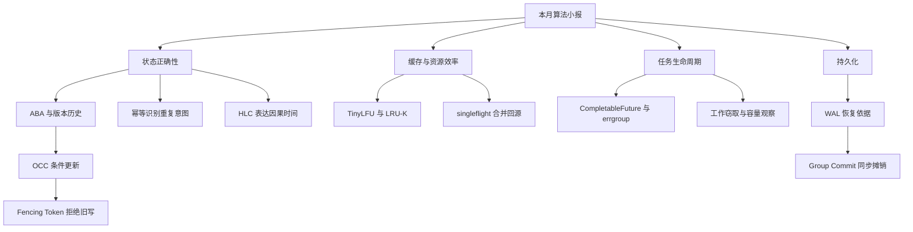

# 算法小报｜从并发正确性到数据效率

**月度整理 · 2026.09.19—2026.10.19 · 7 个主题组 · 25 个知识点**

这一个月的推荐，有一条清楚的主线：先让并发操作不出错，再让有限的线程、缓存、内存和磁盘做更多有效工作。它既包含基础算法，也包含并发 API、分布式机制和数据库工程思想，适合作为后端工程学习小报。

> [!abstract] 三分钟导读
> **正确性**：ABA、OCC、Fencing Token、幂等与 HLC，分别处理状态变化、并发覆盖、过期写入、重复副作用和因果顺序。
> **效率**：TinyLFU、LRU-K、singleflight、工作窃取、组提交，从不同位置减少无效工作。
> **数据组织**：Cuckoo Filter、Radix Tree、跳表、Roaring Bitmap，围绕不同查询需求选择布局。
> **基础训练**：蓄水池抽样、0-1 BFS、合并区间、快慢指针，训练利用问题约束简化算法的能力。

## 阅读说明与目录

本刊交叉整理 Obsidian 的 **14 篇 GitHub 日报、24 篇工作日记**。同一主题在两处出现只计一次，共确认 25 个不同主题：13 个有日报完整知识点模块，12 个从日记摘要或补记恢复。

文中的“介绍、场景、边界、练习”是本次编辑整理，并非全部来自当日推荐原话。来源链接用于确认推荐日期和原记录；对原文只留下主题的条目，明确标注“补充介绍”。特别是 `VarHandle` 和合并区间，不把新增解释冒充原始正文。

- [[#一、并发正确性与分布式状态保护｜5 项]]
- [[#二、缓存命中率、请求合并与对象复用｜4 项]]
- [[#三、并发执行、失败传播与容量判断｜5 项]]
- [[#四、集合表示、前缀检索与有序查询｜4 项]]
- [[#五、崩溃恢复与持久化吞吐｜2 项]]
- [[#六、分布式数据放置｜1 项]]
- [[#七、基础算法与流式处理｜4 项]]
- [[#八、把 25 个知识点串成学习路线]]
- [[#九、本月总结与归档说明]]

分组依据是“解决相近问题、机制可以对照”，不代表组内算法能够相互替代。组内按推荐日期排列。

## 一、并发正确性与分布式状态保护｜5 项

**本组导读：并发系统不仅要检查“值是什么”，还要检查“谁写的、基于哪个版本、是否已经执行过”。**

### 01｜Fencing Token：让过期持锁者写不进去

**推荐日期：09-21 · 日报完整模块**

分布式锁有租约。线程拿锁后发生长时间暂停，租约可能已经过期；另一个线程获得新锁并完成工作后，旧线程仍可能恢复并继续写入。因此，“我曾拿到锁”不能证明“我的写入现在仍有效”。

Fencing Token 为每一轮授权分配递增编号。写请求把编号传到真正接收写入的下游，下游原子检查版本并拒绝过期请求。关键防线在存储或业务写入口，而不是客户端单方面检查锁状态。

- **应用场景**：租约选主后的写入、共享资源修改、可能经历 GC 停顿的后台任务。
- **注意边界**：token 必须可靠地产生、传递并被下游执行检查；同一 token 是否允许多次写入，要按业务协议定义，不能机械照搬单次更新示例。
- **一句话记忆**：锁决定谁有资格，栅栏决定旧资格还能不能生效。

来源：[[GitHub Daily/GitHub-Trending-日报-2026-09-21]]。

### 02｜ABA：值回来了，历史却变了

**推荐日期：09-22 · 日报完整模块**

线程读到值 A，准备通过 CAS 更新。期间别的线程先把它改为 B，又改回 A。旧线程只比较当前值，可能误以为从未发生变化。问题不在于 A 是否相等，而在于业务是否依赖“中间没有变化”这个前提。

原推荐使用带版本的引用，把比较条件从 value 扩展为 value + version。即使值回到 A，版本也已前进，旧操作就不能继续成功。

- **应用场景**：依赖旧快照进行原子更新的状态结构。
- **注意边界**：版本必须随相关变更一起更新；版本回绕、对象回收等问题还需要具体实现处理。本地 CAS 也不自动提供跨进程保证。
- **一句话记忆**：相同的值，不代表相同的状态历史。

来源：[[GitHub Daily/GitHub-Trending-日报-2026-09-22]]。

### 03｜接口幂等：让重试保留同一个业务意图

**推荐日期：09-26 · 日报完整模块**

客户端超时，并不能确定服务端没有执行成功。如果每次重试都被当成新操作，可能重复扣款、创建订单或扣减库存。幂等键为同一次业务意图提供稳定身份，重复请求复用原结果。

真正需要设计的是“处理中、成功、失败”状态，以及去重记录和业务副作用之间的事务关系。仅有 Redis `SETNX`，不足以自动覆盖所有并发与崩溃窗口。

- **应用场景**：订单创建、支付回调、消息消费、自动重试任务。
- **注意边界**：相同 key 携带不同参数应定义冲突规则；去重有效期和业务重试窗口必须匹配；外部副作用需要单独考虑。
- **一句话记忆**：重试可以发生多次，业务意图应被识别为一次。

来源：[[GitHub Daily/GitHub-Trending-日报-2026-09-26]]。

### 04｜OCC：更新前确认自己读到的版本仍有效

**推荐日期：10-04 · 日记摘要**

乐观并发控制（Optimistic Concurrency Control，OCC）允许多个请求先读取和计算，到写入时才检查冲突。例如读取 version=7，更新时要求数据库中的 version 仍为 7，并在成功后推进版本。

影响行数为 0，说明原假设已经失效。此时应重读、重新决策或报告冲突，而不是把旧结果强行覆盖到新状态上。

- **应用场景**：订单状态更新、配置编辑、读多写少的业务记录。
- **注意边界**：冲突频繁时，重试也会消耗资源；单行版本条件不能自动保护跨多行的业务约束。
- **一句话记忆**：先做计算，落笔前再确认纸没有被别人改过。

来源：[[work-docs/daily-journal/2026-10-04]]。

### 05｜HLC：同时保留时间感和因果顺序

**推荐日期：10-16 · 日报完整模块**

物理时钟可能漂移或回拨，不能简单认为本机时间越大，事件就一定越晚发生。纯逻辑计数又缺少接近真实时间的含义。混合逻辑时钟（Hybrid Logical Clock，HLC）结合物理部分和逻辑计数，在接收远端事件时合并推进。

它的核心价值是：若 A 在因果上先于 B，则时间戳应反映这个方向，同时尽量贴近墙上时间。物理时间偏差的控制依赖系统的授时、偏移检测和相应约束。

- **应用场景**：分布式数据库的版本与事务时间戳、跨节点事件因果表达。
- **注意边界**：时间戳排序不能证明两个事件存在因果关系；HLC 本身也不等于共识协议或外部一致性保证。不要把原文的 64 位编码、产品配置值当作所有实现的统一规定。
- **一句话记忆**：既尽量贴近几点几分，也不让因果关系倒着走。

来源：[[GitHub Daily/GitHub-Trending-日报-2026-10-16]]。机制补充参考：[CockroachDB 事务层文档](https://docs.cockroachlabs.com/docs/stable/architecture/transaction-layer)。

**本组总结**：ABA 和 OCC 检查旧快照；Fencing Token 拒绝过期资格；幂等识别重复意图；HLC 表达因果时间。这五件事互相补充，不能用其中一个覆盖其他问题。

## 二、缓存命中率、请求合并与对象复用｜4 项

**本组导读：先分清成本发生在哪里，再选择优化手段。**

### 06｜TinyLFU / W-TinyLFU：先判断值不值得缓存

**推荐日期：09-23 · 日报完整模块**

普通 LRU 关注最近访问，一次性扫描可能把长期热点挤走。TinyLFU 使用紧凑的频率统计，比较候选条目和准备被淘汰的条目，把“是否接纳”单独变成一个决策。

W-TinyLFU 在此基础上保留短期 Window 区，让突发新热点有机会被观察，再决定是否进入主缓存。

- **应用场景**：热点相对稳定，但混有大量一次性访问的本地缓存。
- **注意边界**：需要适应热点变化，不能把“历史上访问多”永远等同于“未来有价值”。
- **观察指标**：命中率、回源量、热点切换后的恢复过程、扫描污染程度。

来源：[[GitHub Daily/GitHub-Trending-日报-2026-09-23]]。

### 07｜sync.Pool：复用可随时丢弃的临时对象

**推荐日期：10-06 · 日记摘要**

`sync.Pool` 用于降低临时对象重复分配的开销。典型对象是可重建的缓冲区：借出、使用、清理后归还，下次有机会复用。

- **应用场景**：短生命周期的 `bytes.Buffer` 等临时工作对象。
- **注意边界**：不能依赖池一定保留某个对象；不能把它当数据库连接池或业务结果缓存。归还前应处理旧状态，归还后不应继续使用同一对象。
- **一句话记忆**：它复用的是工作材料，不负责保存业务事实。

来源：[[work-docs/daily-journal/2026-10-06]]。

### 08｜singleflight：同一个 miss，不要让所有人一起回源

**推荐日期：10-08 · 日记摘要**

缓存中的一个热点 key 失效时，大量并发请求可能同时查库。singleflight 把同一 key 正在执行的加载合并起来，由一个调用完成，其余等待并共享结果。

- **应用场景**：缓存 miss 加载、相同资源的并发刷新。
- **注意边界**：它不是缓存，不会永久保存返回值；不同 key 不会因此自动限流。同一个 Group 的合并范围也不自动覆盖多个进程。
- **一句话记忆**：合并重复劳动，不等于管理全部流量。

来源：[[work-docs/daily-journal/2026-10-08]]。补充参考：[Go singleflight 文档](https://pkg.go.dev/golang.org/x/sync/singleflight)。

### 09｜LRU-K：一次路过，不等于长期热点

**推荐日期：10-17 · 日记摘要**

LRU-K 把多次访问历史纳入替换判断，避免仅因为刚刚访问过，就给予一次性扫描数据过高优先级。它和 TinyLFU 都关心缓存污染，但使用的历史信号和策略位置不同。

- **应用场景**：持续热点与批量扫描混合出现的缓存或缓冲管理。
- **注意边界**：需要维护更多历史信息；对新条目如何处理，需要配套规则。
- **一句话记忆**：多次回来的人，比刚路过一次的人更像常客。

来源：[[work-docs/daily-journal/2026-10-17]]。

| 手段 | 主要处理的问题 | 不直接解决的问题 |
|---|---|---|
| TinyLFU / W-TinyLFU | 哪些条目值得接纳 | 并发 miss 的重复回源 |
| LRU-K | 如何利用多次历史改善替换 | 请求整体限流 |
| singleflight | 同 key 的并发重复加载 | 长期缓存保存、跨进程统一合并 |
| sync.Pool | 临时对象分配与复用 | 业务缓存一致性 |

**本组总结**：准入、替换、加载、对象分配是四个位置。先定位浪费发生在哪一步，再谈优化组合。

## 三、并发执行、失败传播与容量判断｜5 项

**本组导读：并发不是把任务放出去就结束，还要能调度、观察、取消和收口。**

### 10｜CompletableFuture：失败如何沿异步链传播

**推荐日期：09-19 · 日报完整模块**

异步执行阶段抛出的异常，不一定能被调用处外层的同步 `try/catch` 捕获。处理逻辑需要进入异步链。原推荐区分了观察异常与恢复异常：`exceptionally` 可以把失败变成正常兜底值，而 `whenComplete` 常用于观察结果和记录指标。

- **应用场景**：并发远程调用、异步业务链、局部降级。
- **注意边界**：Future 完成超时，不代表底层 HTTP 或 DB 调用已经停止；仍需传递真实 deadline，并考虑取消机制。兜底也会改变调用方能否感知失败。
- **自测问题**：调用方已经收到 fallback 时，远端调用是否还在占连接？

来源：[[GitHub Daily/GitHub-Trending-日报-2026-09-19]]。

### 11｜Work Stealing：让空闲 worker 帮忙

**推荐日期：09-24 · 日报完整模块**

所有线程争抢同一个全局队列，会产生竞争。工作窃取让 worker 优先处理本地任务，在空闲时再从其他 worker 取得任务，从而兼顾局部性和负载均衡。

- **应用场景**：可拆分任务、并行执行框架、运行时调度。
- **注意边界**：任务过细会放大调度成本；具体队列结构和取任务顺序依实现而异，不能把某种 deque 示例直接视为 Go runtime 的完整算法。
- **自测问题**：任务变慢，是 worker 不够，还是任务粒度太小、队列竞争太大？

来源：[[GitHub Daily/GitHub-Trending-日报-2026-09-24]]。

### 12｜VarHandle：理解共享变量访问的不同语义

**推荐日期：10-01 · 日记只确认主题；以下为补充介绍**

Java `VarHandle` 提供变量访问机制，支持普通访问、不同内存顺序语义的访问，以及条件原子更新等操作。学习重点不是背 API 名称，而是辨认哪些操作需要原子性、哪些读写需要可见性与顺序保证。

- **应用场景**：理解底层并发结构和变量访问协议。
- **注意边界**：某个字段有原子访问能力，不代表多字段业务约束自动成为原子事务；不同访问模式不能随意混用。
- **阅读定位**：可与 ABA、CAS 一起学习；本刊不推定 10-01 原消息具体讲了哪些访问模式。

来源：[[work-docs/daily-journal/2026-10-01]]。补充参考：[Oracle VarHandle API 文档](https://docs.oracle.com/en/java/javase/25/docs/api/java.base/java/lang/invoke/VarHandle.html)。

### 13｜Little’s Law：从吞吐和耗时理解在途量

**推荐日期：10-02 · 日记摘要**

利特尔定律使用 `L = λW` 描述平均在途数量、平均有效吞吐与平均停留时间的关系。日记中的例子是：每秒 200 个请求，平均停留 80ms，对应平均约 16 个在途请求。

- **应用场景**：理解请求堆积、连接占用、并发容量之间的联系。
- **注意边界**：需要一致的系统边界和稳定的统计口径；16 个平均在途请求，不等于线程池或连接池就应该直接设为 16，也不能替代峰值和尾延迟分析。
- **自测问题**：吞吐没有增加，响应时间却翻倍，在途请求为什么会增多？

来源：[[work-docs/daily-journal/2026-10-02]]。

### 14｜errgroup：让并发子任务有共同的收口

**推荐日期：10-03 · 日报完整模块**

Go 的 `errgroup` 在等待一组 goroutine 的基础上，加入错误返回机制。使用 `WithContext` 时，首个非空错误会取消派生 context；`Wait()` 仍负责等待子任务退出并返回错误。

- **应用场景**：一个请求拆分为多个需要共同完成的 RPC 或查询。
- **注意边界**：取消是协作式的，任务需要传递并检查 context；单纯使用零值 Group 不会自动获得取消语义。失败后其余任务的既有副作用也不会自动回滚。
- **自测问题**：一个子任务失败后，剩余任务是否实际退出，还是只让调用方知道了失败？

来源：[[GitHub Daily/GitHub-Trending-日报-2026-10-03]]。补充参考：[Go errgroup 文档](https://pkg.go.dev/golang.org/x/sync/errgroup)。

**本组总结**：工作窃取回答任务如何分配；VarHandle 涉及共享状态访问；CompletableFuture 和 errgroup 处理结果与生命周期；Little’s Law 帮助观察运行中的容量关系。

延伸阅读：[[tech-knowledge/并发执行、失败传播与容量判断：五项机制的深度讲解]]。

## 四、集合表示、前缀检索与有序查询｜4 项

**本组导读：没有脱离查询需求的最佳数据结构。**

### 15｜Cuckoo Filter：允许误报的可删除集合过滤

**推荐日期：09-20 · 日报完整模块**

布谷鸟过滤器不保存完整元素，而是保存较短的指纹，查询检查候选桶。插入冲突时，可把已有指纹迁移到另一候选位置。它适合在访问昂贵数据源前先做一层近似过滤。

- **应用场景**：动态 key 集合的存在性预检查、缓存穿透防护。
- **注意边界**：查询命中只是“可能存在”，仍需最终数据源确认；插入失败必须处理，删除也要遵守实现前提，不能看到近似命中就任意删除一个实际未插入的元素。
- **一句话记忆**：用较小空间排除大量不可能，命中后再认真查证。

来源：[[GitHub Daily/GitHub-Trending-日报-2026-09-20]]。

### 16｜Radix Tree：压缩共享前缀

**推荐日期：09-25 · 日报完整模块**

普通 Trie 可能出现很长的单孩子链。基数树把这样的路径压缩成一条边，减少节点，并保留按前缀组织键的能力。

- **应用场景**：最长前缀匹配、路由、配置命名空间。
- **注意边界**：如果只有精确匹配需求，HashMap 往往更直接。路径前缀查询与包含参数、通配符的完整 HTTP 路由语义，也不能直接画等号。
- **一句话记忆**：公共的前缀走一段，不必每个字符都单独占一个节点。

来源：[[GitHub Daily/GitHub-Trending-日报-2026-09-25]]。

### 17｜Skip List：给有序链表增加快速通道

**推荐日期：09-28 · 日报完整模块**

跳表在底层有序链表上增加多级索引，查询从高层向右，再逐层下降。随机层高使查找、插入和删除达到期望 `O(log n)`，不需要通过树旋转维护严格平衡。

- **应用场景**：有序集合、范围扫描、排名。
- **注意边界**：期望复杂度不等于最坏情况保证；索引层也有内存成本。原文的 Redis 示例应理解为跳表编码下的结构，不是所有规模和编码的 ZSet 都统一使用跳表。
- **一句话记忆**：底层保证有序，高层负责快速跳过大段距离。

来源：[[GitHub Daily/GitHub-Trending-日报-2026-09-28]]。关联阅读：[[tech-knowledge/跳表、AVL树与红黑树：概率平衡、旋转与工程选型]]。

### 18｜Roaring Bitmap：面向集合运算的压缩整数集合

**推荐日期：10-14 · 日报完整模块**

Roaring 把整数 ID 分桶，桶内根据数据分布选择数组、位图或连续区间表示。稀疏数据避免浪费大块位图，稠密数据则利用位运算加速交并差。

- **应用场景**：会员与地域标签求交、用户圈选、文档 ID 集合运算。
- **注意边界**：它需要合适的整数 ID 表示，空间收益受分布影响；不能把原推荐“千万级毫秒级”当作跨硬件、数据分布和操作类型的承诺。它与概率过滤器的用途不同。
- **一句话记忆**：让布局跟随数据分布，让集合运算直接利用这种布局。

来源：[[GitHub Daily/GitHub-Trending-日报-2026-10-14]]。关联阅读：[[tech-knowledge/Roaring Bitmap 深入讲解：从压缩布局到精确集合运算]]。

| 主要需求 | 优先理解的结构 | 关键判断 |
|---|---|---|
| 低空间的存在性预过滤 | Cuckoo Filter | 是否接受误报，如何处理删除和插入失败 |
| 前缀与最长前缀匹配 | Radix Tree | 键是否有可利用的前缀结构 |
| 排序、范围与排名 | Skip List | 是否需要持续维护有序关系 |
| 精确整数集合的交并差 | Roaring Bitmap | ID 表示与分布是否合适 |

**本组总结**：先写出要执行的查询，再选择结构。把“可能存在”“匹配哪个前缀”“排名多少”“两个集合的交集”混为一个查询问题，会直接导致选型偏差。

## 五、崩溃恢复与持久化吞吐｜2 项

**本组导读：WAL 讲先保存什么，Group Commit 讲如何共同支付保存成本。**

### 19｜WAL：让数据页的变更有恢复依据

**推荐日期：10-05 · 日记摘要**

预写日志（Write-Ahead Logging，WAL）的核心约束，是相关日志先于数据页持久化。这样即使数据页尚未完全刷盘，系统也能利用日志参与恢复。

- **应用场景**：数据库、持久化存储引擎。
- **注意边界**：WAL 不意味着写了内存日志就已持久化；提交何时确认、日志何时同步、如何处理未提交状态，依赖具体恢复协议。
- **一句话记忆**：改动可以晚点整理到数据页，但恢复依据要先站稳。

来源：[[work-docs/daily-journal/2026-10-05]]。

### 20｜Group Commit：多笔提交共享同步成本

**推荐日期：10-18 · 日报完整模块**

每个事务独立同步落盘，会重复支付较高的 I/O 同步成本。组提交让并发事务形成一批，日志满足持久化条件后，再一起通知相应事务。

原推荐使用 leader/follower 和攒批窗口解释机制，并引到 MySQL binlog 的多阶段处理。窗口越大，可能合并更多请求，但也会增加等待。

- **应用场景**：事务提交、持久化日志的同步摊销。
- **注意边界**：收益取决于并发量和存储特性；不能保证单条延迟完全不变。Kafka 的生产者攒批可以作“批量摊销”类比，但不等于数据库 fsync 组提交具有同一持久性语义。
- **一句话记忆**：多笔事务合乘一趟车，前提是确认大家都已真正上车。

来源：[[GitHub Daily/GitHub-Trending-日报-2026-10-18]]。

**本组总结**：先验证持久性条件，再优化批次和等待时间。不能通过提前宣布成功来“获得吞吐”。

## 六、分布式数据放置｜1 项

### 21｜Rendezvous Hashing：让 key 找到稳定的归属

**推荐日期：10-07 · 日记摘要**

最高随机权重哈希（Highest Random Weight，HRW）对 key 与候选节点组合打分，选择得分最高的节点。它不维护哈希环；节点变化时，仍由未变化节点赢得的 key 可以保持归属。

- **应用场景**：缓存分片、资源归属、分布式任务放置。
- **注意边界**：节点较多时，逐节点打分的成本需要考虑；热点 key 和节点容量不均衡也需要额外策略。各参与者必须对成员集合和打分规则有一致认识。
- **与工作窃取的区别**：HRW 偏向稳定归属；工作窃取偏向运行时负载调整。稳定性和即时均衡是不同目标。

来源：[[work-docs/daily-journal/2026-10-07]]。关联阅读：[[tech-knowledge/Rendezvous-Hashing-最高随机权重哈希：设计哲学、原理与工程实践]]。

**本组总结**：放置算法决定任务或数据去哪里；它不自动证明目标节点健康，也不自动提供一致性。

## 七、基础算法与流式处理｜4 项

**本组导读：这四项属于不同算法范式，共同点是善用问题约束，避免不必要的通用解法。**

### 22｜Reservoir Sampling：不知道总量，也能均匀抽样

**推荐日期：09-27 · 日记摘要**

蓄水池抽样用容量为 k 的样本池处理未知总量的数据流。先放入前 k 项，后续第 i 项按相应概率进入并替换池中条目，让已处理元素有均等机会留在样本里。

- **应用场景**：日志样本、事件流抽样、无法预先知道长度的数据集。
- **复杂度**：扫描 n 项用 `O(n)` 时间，保存样本用 `O(k)` 空间。
- **注意边界**：均匀随机样本不等于分层代表性保证；加权抽样需要采用对应规则，不能随意修改替换概率。

来源：[[work-docs/daily-journal/2026-09-27]]。

### 23｜0-1 BFS：利用二值边权简化最短路

**推荐日期：09-29 · 日记摘要**

当边权只有 0 或 1 时，可使用双端队列维护距离处理顺序。成功松弛一条 0 权边，把目标放到队头；成功松弛一条 1 权边，把目标放到队尾。

- **应用场景**：免费与付费两类转移、以跨区次数为成本的路径模型。
- **复杂度**：标准 0-1 BFS 可达到 `O(V+E)`。
- **注意边界**：需要按距离松弛，而非照搬无权 BFS 的首次发现标记；任意非负权值不能直接套用这一队列规则。

来源：[[work-docs/daily-journal/2026-09-29]]。

### 24｜合并区间：排序后，只维护当前边界

**推荐日期：10-09 · 10-14 日记补记确认；以下为补充介绍**

先按区间起点排序，再从左向右扫描。新区间与当前结果的末尾重叠，就扩展右边界；不重叠则开启新的结果区间。排序把原本可能需要两两判断的问题，转化成一次顺序扫描。

- **应用场景**：时间段合并、范围去重、资源占用区间整理。
- **复杂度**：一般排序方案为 `O(n log n)`，之后扫描为 `O(n)`。
- **注意边界**：闭区间与半开区间的“相接是否合并”规则不同，需先定义业务语义。

来源：[[work-docs/daily-journal/2026-10-14]] 的 10-09 补记；原推荐题号为 LeetCode 56。

### 25｜快慢指针：用速度差发现环

**推荐日期：10-15 · 日记摘要**

慢指针每轮走一步，快指针走两步。若链表存在环，二者进入环后会相遇；若快指针先走到空节点，则不存在环。

- **应用场景**：链表判环，以及可表示为确定性后继关系的状态序列。
- **复杂度**：链表判环为 `O(n)` 时间、`O(1)` 额外空间。
- **延伸练习**：相遇后把一个指针移回起点，让二者等速前进，推导为什么能定位环入口。
- **注意边界**：它不是任意有向图判环的通用替代算法。

来源：[[work-docs/daily-journal/2026-10-15]]。

**本组总结**：流只能读一遍，想到抽样；边权只有 0/1，想到 deque；区间关系复杂，先排序；只有单一后继且空间有限，考虑快慢指针。先发现约束，再选算法。

## 八、把 25 个知识点串成学习路线

### 四条可连续阅读的主线

图中的连接表示建议阅读关系，不表示技术之间存在强制依赖。

### 四轮复习安排

| 轮次 | 阅读组合 | 核心问题 | 小练习 |
|---|---|---|---|
| 第一轮：正确性 | ABA、OCC、Fencing Token、幂等、HLC | 旧请求、重复请求和因果顺序有何不同？ | 画出两个并发请求与一次超时重试的时序 |
| 第二轮：缓存与表示 | TinyLFU、LRU-K、singleflight、sync.Pool，加四种数据结构 | 哪种浪费发生在哪一步？ | 为商品缓存画出准入、命中、回源和复用位置 |
| 第三轮：并发与持久化 | CompletableFuture、errgroup、VarHandle、工作窃取、Little’s Law、WAL、组提交、HRW | 谁调度、谁等待、谁取消、谁保证落盘？ | 跟踪一次超时请求是否真正释放所有资源 |
| 第四轮：基础训练 | 蓄水池抽样、0-1 BFS、合并区间、快慢指针 | 哪个输入约束让算法变简单？ | 每题写出不变量、复杂度和一个反例 |

### 用一条订单链路复盘

订单请求携带稳定幂等键，避免超时重试重复创建；状态更新使用 OCC，避免覆盖并发修改。如果后台任务依赖租约授权，还需考虑旧持锁者写入，判断是否需要下游 fencing。

查询商品时，缓存策略影响什么数据能留下；同 key 并发 miss 可考虑 singleflight。并发查询多个依赖时，用合适的异步机制传播失败并协作取消。平均吞吐与耗时可帮助理解在途量，但容量仍需结合峰值和资源边界评估。

数据库先满足日志与恢复要求，再通过组提交摊销同步成本。这里每一层都只承担自己的保证：缓存命中率不能证明订单正确，接口返回成功也不能替代持久化条件。

> [!tip] 每学一项，回答四个问题
> 1. 它修复的是哪一种具体失败或浪费？
> 2. 它依赖哪些前提？
> 3. 它明确不保证什么？
> 4. 用什么现象或指标证明它发挥了作用？

## 九、本月总结与归档说明

### 内容总结

本月推荐以系统工程为主：按本刊分类，21 项属于系统机制或工程数据结构，4 项属于基础算法与流式处理。这种统计用于理解内容结构，不是严格的学科边界。

最值得集中复习的，是三组容易混淆的概念：**版本检查与重复去重、缓存准入与请求合并、超时返回与真实取消**。它们名称不同、保证不同，却经常出现在同一条业务链路。

这些知识还体现了三个工程取舍：以额外状态换正确性，以统计或随机性换空间与实现成本，以批量等待换吞吐。学习时应同时记住收益与代价，避免只记“更快、更省、更可靠”的结论。

### 来源覆盖与缺口

| 项目 | 已确认情况 |
|---|---|
| 检索时间范围 | 2026-09-19 至 2026-10-19 |
| 读取日报 | 14 篇；其中 13 篇有算法完整模块 |
| 读取日记 | 24 篇 |
| 不同推荐主题 | 25 项；两处重复记录已合并 |
| 仅日记或补记保留 | 12 项；不等同于原消息完整恢复 |
| 09-30 | 日记记载算法任务因连接错误失败，没有生成可发送正文 |
| 10-09 | 合并区间由 10-14 日记补记确认，无独立当日日记 |
| 10-10 至 10-13 | 10-14 日记记载机器停机，无算法推荐产物 |
| 10-19 | 本次检索未发现当日算法推荐记录 |

**特别归档提醒**：10-08 日报已经存在，但未发现算法模块，singleflight 仍以日记为来源。10-14 Roaring Bitmap 当天曾先发群后补追加，应只计一个主题。10-17 日记对“日报缺失”的故障判断，后来被 10-18 日记修正为隔日出刊的正常休刊；本刊采用后续修正，不沿用早期误判。

日记还多次记载“算法只追加到 Obsidian、workspace 镜像未同步”。本刊的来源范围是 Obsidian 原文，不据旧日记中的镜像状态推断当前外部目录或线上站点内容。

### 延伸阅读与核验边界

本刊以已读取的日报和日记为推荐记录真源。官方文档仅用于补充或澄清技术边界，不用于新增当日推荐，也未对全部算法实现进行运行测试。

- [Go errgroup](https://pkg.go.dev/golang.org/x/sync/errgroup)：错误传播、等待与 context 取消。
- [Go singleflight](https://pkg.go.dev/golang.org/x/sync/singleflight)：按 key 抑制重复调用的作用范围。
- [Oracle VarHandle](https://docs.oracle.com/en/java/javase/25/docs/api/java.base/java/lang/invoke/VarHandle.html)：变量访问与访问模式。
- [CockroachDB 事务层](https://docs.cockroachlabs.com/docs/stable/architecture/transaction-layer)：HLC 与事务机制的上下文。

**本期一句话**：先确定需要什么保证，再选机制；先找到成本在哪里，再做优化。
